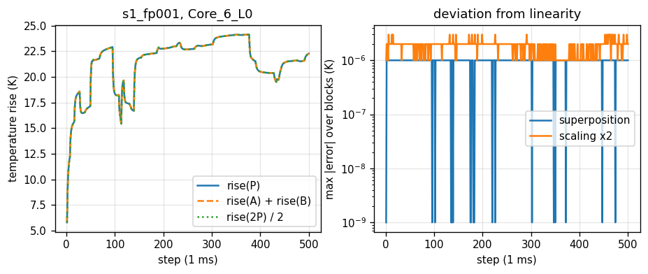

# P0-2: Linearity checks

**Question.** With leakage off, is HotSpot (grid model 64×64, TA layer stack) exactly linear in
power? If so, a linear predictor (influence matrix G, state-space or exponential models) can be
exact, and any later error is a bug or a calibration problem, not physics.

**Reproduce.** `bash experiments/run.sh P0-2_linearity` (inside WSL, about 40 s).

## Setup

- Floorplans: the main subset, one per style: `s1_fp001`, `s2_fp004`, `s3_fp002`, `s4_fp001`.
- Power: TA nominal vector P (big 20 W, little 8 W). A = big cores only, B = little cores only,
  so P = A + B.
- Steady checks: P scaled by 0.5, 2 and 3; zero power; A and B run separately; a 1 W and a 10 W
  step in one little core.
- Transient checks: a 500-step (0.5 s, Δt = 1 ms) phase trace from a cold chip, run as P, 2P, A
  and B.
- "Rise" means temperature minus ambient (45 °C). HotSpot is the patched build with 6-decimal
  output (`setup/`).

## Results

Steady state (max |error| over all blocks, K):

| floorplan | peak at nominal (°C) | ×0.5 | ×2 | ×3 | zero power vs ambient | A + B vs P | 1 W vs 10 W/10 |
|---|---|---|---|---|---|---|---|
| s1_fp001 | 76.4 | 5e-07 | 1e-06 | 1e-06 | 0 | 1e-06 | 3e-07 |
| s2_fp004 | 76.2 | 5e-07 | 1e-06 | 1e-06 | 0 | 6e-14 | 4e-07 |
| s3_fp002 | 70.5 | 5e-07 | 1e-06 | 1e-06 | 0 | 1e-06 | 5e-07 |
| s4_fp001 | 69.3 | 5e-07 | 1e-06 | 1e-06 | 0 | 1e-06 | 5e-07 |

Transient (max |error| over all blocks and all 500 steps, K):

| floorplan | ×2 | A + B vs P | largest rise in the trace (K) |
|---|---|---|---|
| s1_fp001 | 3e-06 | 1e-06 | 24.1 |
| s2_fp004 | 3e-06 | 1e-06 | 23.4 |
| s3_fp002 | 3e-06 | 1e-06 | 18.7 |
| s4_fp001 | 2e-06 | 1e-06 | 16.0 |

## Conclusion

- HotSpot is linear and superposable **to the last printed digit** (10⁻⁶ K). The deviations are
  just the rounding of the 6-decimal output. With the stock 2-decimal output they would have been
  0.005 K, which is why the precision patch matters.
- Zero power gives exactly ambient, so `T = T_amb + G·P` has no offset term.
- A 1 W calibration step is as good as a 10 W one (5×10⁻⁷ K difference). P1-1 uses 1 W steps.
- The transient is linear too, so T2 (ARX), T3 (exponentials) and T4 (state space) can be exact
  in principle.

## Files

- `results/steady_linearity.csv`, `results/transient_linearity.csv`: the tables above.
- `results/transient_linearity.png`: one core's trace and the deviation over time.
- `results/summary.json`, `results/log.txt`.
