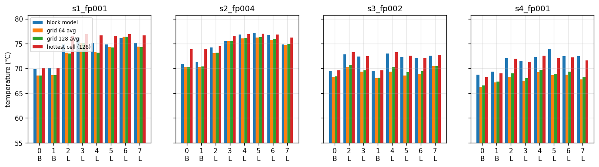
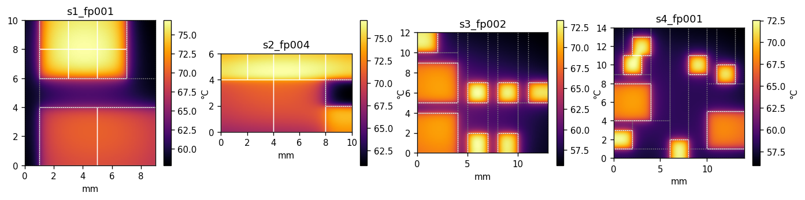

# P0-3: Block vs grid model, grid resolution, hot spots inside cores

**Question.** The TA runs HotSpot's grid model at 64×64. How different is the block model, is
64×64 fine enough, and how much hotter is the hottest spot inside a core than the core's average
temperature (which is what the predictor and DTM see)?

**Reproduce.** `bash experiments/run.sh P0-3_block_vs_grid` (about 30 s).

## Setup

- Main subset (`s1_fp001`, `s2_fp004`, `s3_fp002`, `s4_fp001`), TA nominal power (big 20 W,
  little 8 W, 88 W in total), example1 package, ambient 45 °C.
- Block model: same floorplan, silicon set to the TA values (k = 100 W/m·K, 150 µm); it has no
  layer file, so the TIM comes from the config (same 20 µm, k = 4).
- Grid model at 32, 64 and 128 cells per side with the TA `.lcf`.
- "HotSpot average" = the block temperature HotSpot writes. "Area average" = the exact
  area-weighted mean of the map over the core (computed by us). "Hottest cell" = the hottest
  grid cell whose centre lies inside the core.

## Results

All values are the worst core of each floorplan (K).

| floorplan | block vs grid 64 | grid 64 vs 128 (HotSpot avg) | grid 64 vs 128 (area avg) | HotSpot avg vs area avg (64) | hottest cell − avg (64) | hottest cell − avg (128) | peak core avg, 64 (°C) | peak cell, 128 (°C) |
|---|---|---|---|---|---|---|---|---|
| s1_fp001 | 1.89 | 0.13 | 0.03 | 0.10 | 3.33 | 3.53 | 76.4 | 76.9 |
| s2_fp004 | 1.14 | 0.15 | 0.01 | 0.19 | 3.99 | 3.70 | 76.2 | 77.0 |
| s3_fp002 | 3.72 | 0.89 | 0.13 | 0.97 | 3.95 | 3.32 | 70.5 | 73.3 |
| s4_fp001 | 5.36 | 0.62 | 0.15 | 0.90 | 3.79 | 3.31 | 69.3 | 72.5 |

HotSpot time for one steady run (median of 5, includes process start-up):

| model | time |
|---|---|
| block | 1.4 ms |
| grid 32×32 | 33 ms |
| **grid 64×64 (reference)** | **0.27 s** |
| grid 128×128 | 2.6 s |

## Conclusion

- **The block model is not a substitute for the grid model here.** It differs by 1–5 K, most on
  the large sparse dies (Style_3/4), where the zero-power white space matters. We use the grid
  model as the reference, as the TA does.
- **64×64 is fine enough physically.** The true area averages change by at most 0.15 K from 64
  to 128 cells.
- **HotSpot's own block average has a quirk.** It counts partially covered edge cells with full
  weight, so a 2×2 mm core on a 14 mm die (about 9 cells across) also averages in some cooler
  white space. That moves the reported temperature by up to about 1 K compared with the true
  area average, and it is why 64 vs 128 differ by up to 0.9 K in HotSpot's numbers. **This does
  not affect the predictor.** It predicts HotSpot's reported numbers, and the quirk is linear in
  power like everything else. It should be mentioned in the report as a property of the
  reference.
- **Hot spots are real.** The hottest cell inside a core is 3.3–4 K above the core's average,
  for big and little cores alike (see the maps: heat concentrates in the middle of each core).
  A DTM limit applied to core averages would let the real peak run about 4 K higher. This is
  the "block-level model may hide hot spots" risk in the scope, now measured. P2-3 calibrates
  the hottest cell per core directly.
- **Little cores run hotter than big cores** (about 74–76 °C against 68–70 °C at nominal power),
  because their power density is higher (2.0 against 1.25 W/mm²).
- One steady grid run takes 0.27 s. This is the HotSpot time the predictor is compared against
  in §1.4 of the plan.

## Files

- `results/summary.csv`: the table above. `results/per_core.csv`: every core, every model.
- `results/timing.csv`, `results/per_core.png`, `results/maps_128.png`, `results/log.txt`.
