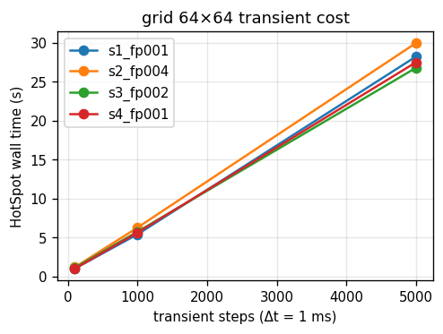

# P0-4: Infrastructure (HotSpot build, runner, parser, parallel runs) and HotSpot timing

**Question.** Can we run HotSpot reliably, precisely and fast enough for calibration and testing?
How long does HotSpot itself take? (That is the time the predictor is compared against.)

**Reproduce.** Build once: `bash setup/build_hotspot_ltp.sh`. Then
`bash experiments/run.sh P0-4_infrastructure` (about 6 min).

## What was built

| Piece | File | What it does |
|---|---|---|
| Patched HotSpot | `setup/build_hotspot_ltp.sh`, `setup/ltp.patch`, `setup/patch_be_cache.py` | Copies the HotSpot source to `~/projects/HotSpot-ltp` and applies two patches (below). The stock build is untouched. |
| Configs | `configs/base_grid64.config`, `configs/base_block.config` | example1 package (ambient 45 °C, spreader 30 mm, sink 60 mm), grid model at 64×64 |
| Floorplan loader | `src/sim/floorplans.py` | Reads the TA folders and `.flp` files; tags each block big/little/FILL by size; gives power ranges as densities (TA ranges on TA cores); writes a TA-style `.lcf` for our own floorplans (HET-A, EV6) |
| Runner and parser | `src/sim/hotspot.py` | `steady(fp, P)` and `transient(fp, P, dt)`. Each run gets its own folder under `~/ltp_runs/<group>/` with inputs, outputs and `meta.json` (command, config, git commit, wall time) |
| Grid ↔ block mapping | `src/sim/gridmap.py` | Reproduces HotSpot's block averages from the 64×64 map exactly (to 5×10⁻⁷ K) |
| Power generators | `src/sim/powergen.py` | Random steady vectors, phase traces, calibration excitation traces, all from seeds |
| Parallel runs | `src/sim/parallel.py` | `pmap(fn, jobs)` over processes |
| Experiments | `experiments/<ID>_<name>/` | `run.py`, `README.md`, `results/`; run with `bash experiments/run.sh <ID>_<name>` |

### The two HotSpot patches

1. **Precision.** HotSpot prints temperatures with 2 decimals (0.01 K steps). That would swamp
   errors far smaller than 0.01 K and add noise to every fit. The patch changes `%.2f` to `%.6f` in
   the functions that write `.steady`, `.ttrace` and grid files (11 lines).
2. **Speed (LU caching).** In the grid model with SuperLU, HotSpot's transient does one
   backward-Euler step per sampling interval: it solves `(C/h + G) T_new = C/h T_old + P`. Stock
   HotSpot re-factorises the matrix `C/h + G` at every step, although it only changes when `h`
   changes. The patch factorises once per step size and reuses the factors. **The output is
   bit-identical** (checked below).

Note: since HotSpot takes exactly one backward-Euler step per interval, HotSpot's transient is a
fixed linear discrete-time system for a given Δt. This matters for the transient models in P1.

## Results

**Patch check** (s4_fp001, 300 steps of 1 ms):

| output identical to precision-only build | max difference | precision-only build | patched build | speed-up |
|---|---|---|---|---|
| yes, byte for byte | 0 K | 70.1 s | 2.4 s | **29×** |

**HotSpot cost, grid 64×64** (the reference in all experiments):

| run | time |
|---|---|
| one steady run (all 23 TA floorplans; median, range) | **0.24 s** (0.235–0.258 s) |
| transient, per 1 ms step | **5.2–5.9 ms** (+ 0.1–0.5 s set-up per run) |
| transient, stock HotSpot, per step | about 230 ms |

**Parallel runs** (92 steady runs; WSL with 20 logical CPUs and 7 GB RAM):

| workers | runs/s | median time of one run |
|---|---|---|
| 1 | 2.4 | 0.24 s |
| 2 | 4.8 | 0.26 s |
| 4 | 7.6 | 0.32 s |
| **8** | **10.5** | 0.58 s |
| 12 | 9.5 | 1.08 s |
| 16 | 9.3 | 1.47 s |

## Conclusion

- The pipeline works and is reproducible. Every run records its command, config and git commit.
- The precision patch is necessary: P0-2 shows linearity holds to 10⁻⁶ K, which 2 decimals
  could not show.
- The LU-caching patch makes transient ground truth practical: a 60 s trace at 1 ms (60,000
  steps) now takes about 5 minutes instead of about 4 hours. Results are unchanged.
- **HotSpot reference times** for the predictor comparison: 0.24 s per steady solution and about
  5.5 ms per transient step (grid 64×64, one process, including start-up for steady).
- Parallel speed-up stops at about 8 runs at once, because HotSpot's sparse solves are limited by
  memory bandwidth rather than CPU. `parallel.py` therefore uses 8 workers by default.
- With one worker, about 0.17 s per run is our own overhead (folders, files, process start).
  That is fine for now.

## Files

- `results/steady_timing.csv`, `results/transient_timing.csv` (+ `.png`),
  `results/parallel_scaling.csv`, `results/summary.json`, `results/log.txt`.
