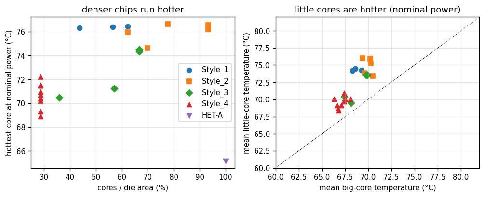
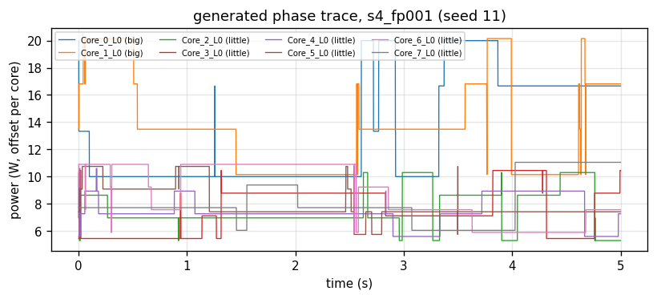

# P0-5: TA floorplans, power and traces

**Question.** Can we load and run all the TA floorplans? Do the TA power ranges give plausible
temperatures with our package? Which cores get hottest?

**Reproduce.** `bash experiments/run.sh P0-5_ta_floorplans` (about 10 s).

## Setup

- (a) **Loader** (`src/sim/floorplans.py`): reads every `data/sample_dataset/2D_floorplans/Style_k/fp_XXX`
  folder as-is (`.flp`, `.lcf`, `_tim.flp`) and names it `s<k>_fp<XXX>`. Blocks are tagged by
  size: 4×4 mm = big, 2×2 mm = little, `FILL_*` = zero-power white space. HET-A (from
  `flpgen.py`, branch `p0-flpgen`) gets the same TA layer stack.
- (b) **Power** (`src/sim/powergen.py`), always by core type, never copied from the TA ptraces:
  - nominal: big 20 W, little 8 W (the TA values);
  - max: big 20 W, little 10 W (top of the TA ranges);
  - random steady vectors, uniform in big 10–20 W and little 5–10 W;
  - phase traces: each core runs phases of random length (1 ms to 2 s, log-uniform) at one of 4
    levels in its range, with all cores switching independently.

  On HET-A, whose cores are smaller, the same power *densities* are used (big 0.625–1.25 W/mm²,
  little 1.25–2.5 W/mm²; L2 and NoC 0.05–0.2 W/mm²).
- (c) Steady runs of all 24 floorplans at nominal and max power (grid 64×64, ambient 45 °C).

## Results

| floorplan | die (mm) | cores/die | hottest core avg, nominal (°C) | hottest core | hottest cell, nominal (°C) | hottest core avg, max (°C) | hottest cell, max (°C) |
|---|---|---|---|---|---|---|---|
| s1_fp001 | 9×10 | 62% | 76.4 | Core_6 (little) | 76.9 | 82.9 | 83.4 |
| s1_fp002 | 9×11 | 57% | 76.4 | Core_3 (little) | 76.7 | 82.9 | 83.3 |
| s1_fp003 | 16×8 | 44% | 76.3 | Core_4 (little) | 76.5 | 82.6 | 82.8 |
| s2_fp001 | 10×8 | 70% | 74.6 | Core_1 (little) | 75.7 | 80.5 | 81.8 |
| s2_fp002 | 9×10 | 62% | 76.0 | Core_1 (little) | 76.4 | 81.8 | 82.5 |
| s2_fp003 | 12×6 | 78% | 76.6 | Core_2 (little) | 77.5 | 82.9 | 84.0 |
| s2_fp004 | 10×6 | 93% | 76.2 | Core_5 (little) | 77.0 | 82.3 | 83.3 |
| s2_fp005 | 10×6 | 93% | 76.5 | Core_2 (little) | 77.3 | 82.7 | 83.7 |
| s3_fp001 | 7×14 | 57% | 71.3 | Core_3 (little) | 73.8 | 76.5 | 79.6 |
| s3_fp002 | 13×12 | 36% | 70.5 | Core_7 (little) | 73.3 | 75.3 | 78.7 |
| s3_fp003 | 14×6 | 67% | 74.3 | Core_5 (little) | 76.1 | 80.1 | 81.7 |
| s3_fp004 | 6×14 | 67% | 74.5 | Core_4 (little) | 75.8 | 80.2 | 81.7 |
| s3_fp005 | 14×6 | 67% | 74.5 | Core_4 (little) | 75.8 | 80.2 | 81.7 |
| s4_fp001 | 14×14 | 29% | 69.3 | Core_4 (little) | 72.5 | 73.9 | 77.9 |
| s4_fp002 | 14×14 | 29% | 70.2 | Core_3 (little) | 74.0 | 75.0 | 79.8 |
| s4_fp003 | 14×14 | 29% | 71.5 | Core_4 (little) | 74.1 | 76.9 | 80.2 |
| s4_fp004 | 14×14 | 29% | 70.7 | Core_2 (little) | 73.7 | 75.6 | 79.3 |
| s4_fp005 | 14×14 | 29% | 68.9 | Core_7 (little) | 72.5 | 73.4 | 77.8 |
| s4_fp006 | 14×14 | 29% | 70.4 | Core_3 (little) | 73.8 | 75.2 | 79.5 |
| s4_fp007 | 14×14 | 29% | 71.5 | Core_2 (little) | 74.4 | 76.3 | 80.1 |
| s4_fp008 | 14×14 | 29% | 71.5 | Core_4 (little) | 74.5 | 76.3 | 80.1 |
| s4_fp009 | 14×14 | 29% | 71.0 | Core_6 (little) | 74.3 | 75.7 | 80.0 |
| s4_fp010 | 14×14 | 29% | 72.2 | Core_5 (little) | 74.8 | 77.5 | 80.8 |
| het_a | 6×5 | 100% | 65.2 | Little3 (little) | 65.3 | 69.7 | 69.9 |

**The TA's own Style_2 ptraces** (20 W on two 2×2 mm cores) against power assigned by size:

| floorplan | TA ptrace: hottest core (°C) | TA ptrace: hottest cell (°C) | by size: hottest core (°C) | by size: hottest cell (°C) |
|---|---|---|---|---|
| s2_fp001 | 98.1 | 101.0 | 74.6 | 75.7 |
| s2_fp002 | 96.9 | 100.7 | 76.0 | 76.4 |
| s2_fp003 | 99.2 | 102.1 | 76.6 | 77.5 |
| s2_fp005 | 99.7 | 102.0 | 76.5 | 77.3 |

## Conclusion

- All 23 TA floorplans load and run unchanged, with 2 big + 6 little cores each. HET-A runs with
  the same stack.
- **Temperatures are plausible with the example1 package:** 69–77 °C hottest core at nominal
  power, 73–83 °C at maximum power. So the TA ranges and our package fit together; no change is
  needed (the plan's 60–110 °C sanity range).
- **A little core is the hottest core on every floorplan.** Little cores have 1.6× the power
  density of big cores (2.0 against 1.25 W/mm² nominal) and run 2–6 °C hotter on average (right
  figure). For DTM this means "move the task to a little core" is not automatically cooler.
- **Packing matters more than die size alone.** Style_4 (14×14 mm, 29 % cores, scattered) is
  coolest. Style_1 fp_003 has lots of white space (44 %) but clusters its little cores, so it is
  as hot as the densest Style_2 chips.
- **The Style_2 ptrace problem is real.** Used as given, those files put 5 W/mm² on little cores
  and the chip reaches about 100 °C, 23 °C hotter than with power assigned by size. We always
  assign power by size. This should be reported to the TA.
- **s3_fp004 is s3_fp005 rotated by 90°** (x and y swapped), so both give identical
  temperatures; the square spreader and sink make the package symmetric. The two are not
  independent samples (relevant for P1-3).
- (d), generating more floorplans in each TA style (`dataset.md` §1.9), is done separately in
  `experiments/P0-5d_generated_floorplans/`.

## Files

- `results/inventory.csv`: blocks, types, die, power per floorplan.
- `results/temperatures.csv`: nominal and max results, including mean big and little temperatures.
- `results/style2_ptrace_check.csv`, `results/peak_vs_density.png`,
  `results/phase_trace_example.png`, `results/summary.json`, `results/log.txt`.
