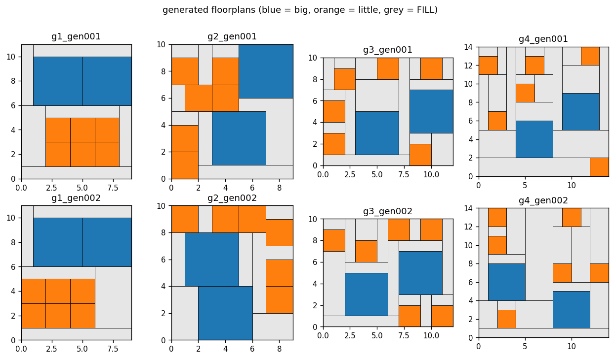

# P0-5(d): More floorplans in the TA styles

**Question.** The TA README calls the sample floorplans "templates for generating more data", and
the TA asks us to expand the dataset. Can we generate more floorplans that behave like the TA's?

**Reproduce.** `bash experiments/run.sh P0-5d_generated_floorplans` (about 1 min). The floorplans
are written to `data/generated/Style_k/gen_XXX/` by `src/sim/tagen.py` on first use.

## How they are generated (`src/sim/tagen.py`)

Same cores as the TA set (2 big 4×4 mm, 6 little 2×2 mm), same files (`.flp`, `_tim.flp`,
`.lcf`) and layer stack, whole-millimetre coordinates. The white space is tiled with FILL
rectangles, so every layer covers the die. The rules imitate each style; they are not the TA's
own generator:

| style | rule | dies used |
|---|---|---|
| Style_1 | big cores side by side; little cores in a 3×2 (or 2×3) cluster; ≥ 1 mm between the groups | 9×10, 9×11, 16×8, 10×10, 11×9 |
| Style_2 | random placement with no gaps required, on small dies | 10×8, 9×10, 12×6, 10×6, 8×8, 12×7 |
| Style_3 | ≥ 1 mm between cores, elongated or larger dies | 7×14, 13×12, 14×6, 6×14, 12×10, 8×13 |
| Style_4 | ≥ 1 mm between cores, 14×14 mm die, cores scattered | 14×14 |

10 per style, 40 in total, all checked to tile the die exactly.

## Results

Hottest core at TA nominal power (88 W), generated vs TA, per style:

| style | set | n | hottest core (°C) | cores / die area |
|---|---|---|---|---|
| Style_1 | TA | 3 | 76.3–76.4 | 44–62 % |
| Style_1 | generated | 10 | 75.0–77.0 | 44–57 % |
| Style_2 | TA | 5 | 74.6–76.6 | 62–93 % |
| Style_2 | generated | 10 | 73.2–75.4 | 62–93 % |
| Style_3 | TA | 5 | 70.5–74.5 | 36–67 % |
| Style_3 | generated | 10 | 70.1–71.6 | 36–57 % |
| Style_4 | TA | 10 | 68.9–72.2 | 29 % |
| Style_4 | generated | 10 | 68.7–69.9 | 29 % |

## Conclusion

- The generated floorplans run in HotSpot unchanged and fall in the same temperature range as
  the TA floorplans of the same style, so they are a plausible expansion of the dataset.
- They are slightly cooler on average. Random placement clusters little cores less often than the
  TA's layouts, and generated "Style_2" chips are less tightly packed than the TA's.
- Used in P1-3 (d2/d3) as extra training data for the calibration-free regression baselines.
  They did not close the gap to calibration, which supports the case for per-floorplan
  calibration rather than "more data".

## Files

- `data/generated/` (the 40 floorplans), `results/floorplans.csv`, `results/summary.csv`,
  `results/examples.png`, `results/log.txt`.
