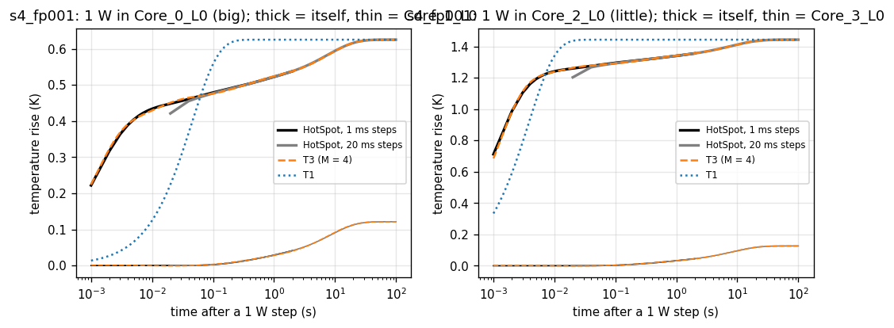
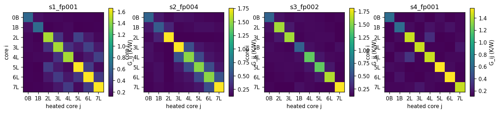
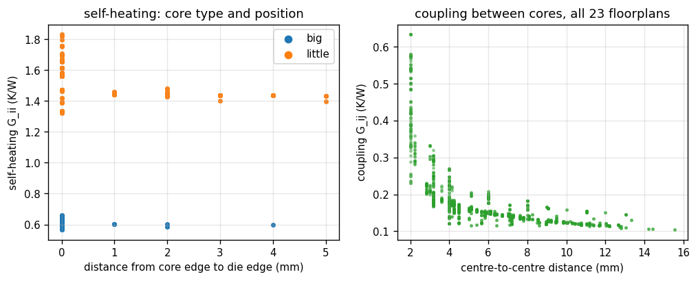

# P1-1: Calibration by unit-step runs (S1, T1, T3)

**Question.** Can a few planned HotSpot runs per floorplan determine the predictor's
coefficients? What does calibration cost, and how well do the models fit the calibration runs?

**Reproduce.** `bash experiments/run.sh P1-1_step_calibration` (about 70 min the first time,
mostly HotSpot; the runs are cached in `~/ltp_runs/calib/`, so refitting takes minutes).
The calibration stage itself is `src/ltp/calibrate.py`; the models are in `src/ltp/models.py`.

## Setup

For each of the 24 floorplans (23 TA + HET-A), with N = 8 power inputs, **3N = 24 HotSpot runs**:

| run | what | gives |
|---|---|---|
| N steady runs, 1 W in one core | block temperatures and the 64×64 map | **S1**: G (exact, P0-2), and G_cells for P2-3 |
| N transient runs, 1 W step, Δt = 1 ms, 2,000 steps | fast part (0–2 s) of every step response | T1, T3 |
| N transient runs, 1 W step, Δt = 20 ms, 5,000 steps | slow heat-sink tail (2–100 s) | T1, T3 |

The step responses are merged on a log-spaced time axis (1 ms to 100 s, 1 ms data up to 2 s and
20 ms data after), then fitted:
- **T1**: each output relaxes to its S1 value with one time constant τ_i (least squares).
- **T3**: s_ij(t) = Σ_m a_ijm (1 − e^(−t/τ_m)) with M time constants shared by all core pairs,
  fitted by variable projection, with Σ_m a_ijm = G_ij fixed so the steady state is exact.
  M = 1 … 6.

"Fit error" is the worst error over time (1 ms to 100 s) of each model's response to a step from
a cold chip to TA nominal power (88 W), against the calibration runs. Test-set accuracy comes
later (P2-1 steady, P3-1 transient).

## Results

**Calibration cost per floorplan**

| | HotSpot runs | HotSpot time |
|---|---|---|
| S1 only (steady runs) | 8 | 4.3 s |
| S1 + T1 + T3 (all runs) | 24 | about 5 min on one core (1,310 CPU-s with 8 runs in parallel, which slows each run down; see P0-4) |
| all 24 floorplans | 576 | 66 min wall time |

**Fit error vs model order** (worst over 24 floorplans; size for N = 8 cores and 11–25 output blocks):

| model | median fit error | worst fit error | size (median, bytes) |
|---|---|---|---|
| T1 (one τ per output) | 13.6 K | 14.1 K | 1,044 |
| T3 M = 1 | 13.1 K | 14.0 K | 936 |
| T3 M = 2 | 2.36 K | 2.82 K | 1,872 |
| T3 M = 3 | 0.83 K | 1.04 K | 2,808 |
| **T3 M = 4** | **0.30 K** | **0.46 K** | 3,744 |
| T3 M = 5 | 0.10 K | 0.18 K | 4,680 |
| T3 M = 6 | 0.061 K | 0.12 K | 5,616 |

Fitted time constants (s1_fp001, M = 6): 0.97 ms, 2.9 ms, 26 ms, 89 ms, 0.56 s, 8.1 s.

**What G looks like** (23 TA floorplans):

| coefficient | range |
|---|---|
| self-heating, big core | 0.59–0.66 K/W |
| self-heating, little core | 1.42–1.61 K/W (per-floorplan mean); single cores 1.33–1.85 K/W |
| coupling between two cores | 0.10–0.63 K/W |
| S1 size | 512 B (8×8, cores only); 704–1,216 B with FILL outputs |

## Conclusion

- **Calibration works with very few runs.** S1 needs only 8 steady runs (4 s of HotSpot) and is
  exact by construction (HotSpot is linear, P0-2). Adding 16 transient step runs gives every
  transient model; this is well under the plan's "≤ N + 1 runs for steady, ≤ 2 min" target for S1,
  and about 5 CPU-minutes for everything.
- **The thermal response has very different time scales**, from about 1 ms (silicon under the
  core) to about 8 s (heat sink). About 70 % of a core's self-heating appears within 10 ms; the
  rest arrives over tens of seconds (figure).
- **T1 cannot capture this.** One time constant per output is 13–14 K wrong somewhere along a
  step: either too slow at the start or too fast at the end. T1 stays only as a lower bound.
- **T3 converges quickly with M**: 0.3–0.46 K worst-case fit error at M = 4 (about 1 % of the
  30 K rise), 0.06–0.12 K at M = 6, for 3.7–5.6 kB. The plan's expectation "near-exact with
  M = 3–5" holds. Test accuracy follows in P3-1.
- **Heterogeneity shows up clearly in G.** A little core heats itself about 2.4× as much per watt
  as a big core (1.5 against 0.62 K/W), because the same watt goes into a quarter of the area.
  Cores on the die edge heat themselves more (little: up to 1.85 K/W on the edge, about 1.44 K/W
  inside), since heat cannot spread outwards. So **position matters, not just core type**, which
  is what P1-3 tests.
- Coupling falls with distance and levels off at about 0.1 K/W: the shared heat-sink term S2
  exploits.

## Files

- `results/models/<floorplan>_{S1,T1,T3_M1..6}.npz`: the calibrated models (192 files, 1.4 MB).
- `results/calibration_summary.csv`: cost and G statistics per floorplan.
- `results/fit_errors.csv`, `results/fit_error_vs_M.csv`: fit errors and fitted τ's.
- `results/G_heatmaps.png`, `results/G_vs_geometry.png`, `results/step_response_fits.png`,
  `results/summary.json`, `results/log.txt`.
