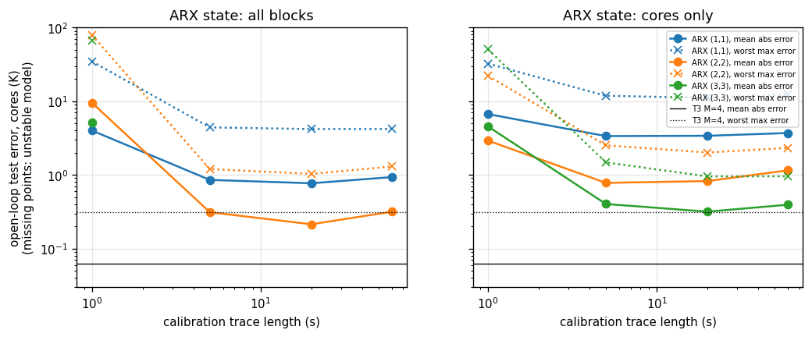

# P1-2: Calibration from one trace (T2, ARX), and how long that trace must be

**Question.** Instead of planned unit-step runs (P1-1), can the transient predictor be calibrated
from *one* long HotSpot trace with rich power changes? How long must that trace be? This is the
cheapest way to calibrate if you can only record one run.

**Reproduce.** `bash experiments/run.sh P1-2_trace_calibration` (about 25 min the first time,
mostly the four 60 s HotSpot traces; cached in `~/ltp_runs/datasets/`).

## Setup

- Main subset (s1_fp001, s2_fp004, s3_fp002, s4_fp001).
- **Calibration trace:** 60 s at Δt = 1 ms (60,000 steps) from a cold chip. Every core
  independently switches between random levels in its TA range, with phases of 1 ms to 5 s
  (log-uniform), so short and long time scales are excited. Prefixes of 1, 5, 20 and 60 s are used.
- **T2 (ARX):** x[k] = Σ_l A_l x[k−l] + Σ_l B_l P[k−l], fitted by least squares with the steady
  gain fixed to S1's G (so the steady state is exact). Orders (na, nb) = (1,1), (2,2), (3,3).
  - "all blocks": the state is every block's temperature (cores and FILL);
  - "cores only": just the 8 core temperatures (what on-chip sensors give).
- **Test:** two unseen 10 s phase traces per floorplan (8 traces), **open loop** from a cold chip:
  the model only sees the power, never HotSpot's temperatures. Errors over cores.
- Reference: T3 (M = 4) from P1-1's step runs, on the same test traces.

## Results

Mean abs error / worst max error over the 8 test traces (K). "unstable" = the open-loop
recursion diverges.

| state, order | 1 s trace | 5 s | 20 s | 60 s | size |
|---|---|---|---|---|---|
| all blocks, (1,1) | 4.0 / 35 | 0.85 / 4.4 | 0.77 / 4.2 | 0.93 / 4.2 | 6.6 kB |
| **all blocks, (2,2)** | 9.5 / 79 | 0.31 / 1.2 | **0.21 / 1.03** | 0.32 / 1.3 | 13.2 kB |
| all blocks, (3,3) | 5.2 / 67 | unstable | unstable | unstable | 19.8 kB |
| cores only, (1,1) | 6.7 / 32 | 3.4 / 12 | 3.4 / 11 | 3.7 / 12 | 1.0 kB |
| cores only, (2,2) | 2.9 / 22 | 0.78 / 2.5 | 0.82 / 2.0 | 1.15 / 2.3 | 2.0 kB |
| cores only, (3,3) | 4.6 / 51 | 0.40 / 1.5 | 0.32 / 0.95 | 0.39 / 0.96 | 3.1 kB |
| *T3 M = 4 (step runs, P1-1)* | | | *0.062 / 0.31* | | 6.4 kB |

Calibration cost: one 60 s trace is 60,000 HotSpot steps, about 5.5 min on an idle core (1,250 s
each here, with four running in parallel). The 20 s prefix that works best costs a third of that.

## Conclusion

- **One trace can calibrate a usable transient model, but it must be at least about 5 s long.**
  With 1 s, the slow heat-sink part is never seen and every ARX model is 3–10 K off on average.
  From 5 s on, the error flattens: the steady gain is fixed to G, so the model does not need
  to *see* the sink settle, only enough of its trend.
- **Longer is not better beyond about 20 s.** The 60 s fits are worse than the 15–20 s ones
  (mean 0.32 K against 0.21 K; the open-loop error is lowest near 15 s and then rises smoothly on
  every floorplan; `diagnose_length.py`, `results/length_diagnostic.*`). What the data show: the
  fit minimises the one-step-ahead error, which is already tiny (0.0002–0.0005 K) and flat in the
  trace length, while the test runs the model open loop for 10,000 steps. The fitted recursion
  has a pole at 0.9999 (slowest time constant 6–8 s), so coefficient changes the one-step fit
  cannot see are amplified over thousands of steps; the fitted slowest time constant drifts from
  7.7 s (5 s trace) to 6.4 s (60 s), against about 8.1 s for HotSpot (P3-4). An earlier version of
  this README blamed "long, quiet phases"; that is not supported, since the power changes at the
  same rate in seconds 0–20 and 20–60 (about 14 changes/s). We did not prove this is the whole
  cause and did not test a fix (fitting the open-loop error directly, or using 15–20 s).
- **Order matters, and too high an order is dangerous.** Two lags clearly beat one (several time
  scales need more than one state per block), but (3,3) on all blocks is unstable in open loop:
  a fit with a tiny one-step error can still have poles outside the unit circle. A stability
  check is needed if ARX is ever shipped.
- **Unmeasured nodes matter.** With only core temperatures as state (no FILL), the best model
  needs 3 lags to reach 0.32 K mean error. The hidden nodes (white space, spreader, sink) must
  be reconstructed from the history.
- **T3 from planned step runs is the better calibration**: 3–5× more accurate than the best ARX
  (0.06 against 0.21 K mean, 0.31 against 0.95–1.03 K worst), stable by construction, and
  needing no long trace. ARX remains useful as a run-time predictor from sensors (P3-2).
  The plan's choice of T3 for the product is confirmed.

## Files

- `results/all_results.csv` (every floorplan × test trace × model), `results/summary.csv`,
  `results/error_vs_trace_length.png`, `results/summary.json`, `results/log.txt`.
- `diagnose_length.py` (reads the cached traces in `data/generated_traces/npz`; needs the 8 steady
  runs per floorplan for G) writes `results/length_diagnostic.csv`,
  `results/length_diagnostic_activity.csv`, `results/length_diagnostic_mean.json` and
  `results/length_diagnostic.png`.
