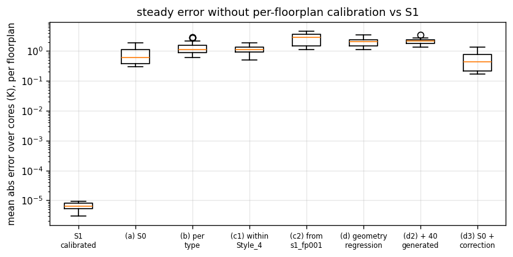
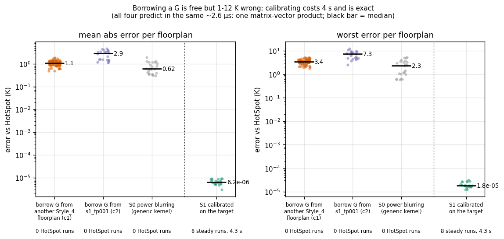

# P1-3: Is per-floorplan calibration needed?

**Question.** The problem statement asks for a one-time calibration *per floorplan*. Is that
really necessary, or could a predictor that never runs HotSpot on the target floorplan do as well?
The TA data is ideal for this: all 23 floorplans have the same 8 cores (2 big, 6 little) and the
same power ranges; only the layout differs. Style_4's 10 floorplans even share the same 14×14 mm
die.

**Reproduce.** `bash experiments/run.sh P1-3_is_calibration_needed` (needs P1-1's cache; about
10 min the first time for the test set and the generated floorplans' runs).

## Setup

Test set (never used for fitting): for every TA floorplan, the TA nominal vector, the max vector
and 300 random power vectors within the TA ranges, run in HotSpot (6,946 steady runs). Errors are
over the 8 cores.

| method | HotSpot runs on the target floorplan | what it knows |
|---|---|---|
| **S1 calibrated** | 8 (P1-1) | the target floorplan's own G |
| (a) S0 power blurring | 0 | one radial heat-spread kernel from a single point-source run on a 28 mm reference die |
| (b) per core type | 0 | self-heating per core type and coupling vs distance per type pair, learned from the other 22 floorplans |
| (c1) transfer within Style_4 | 0 | another Style_4 floorplan's G (same die, same cores; cores matched by type and index); all 90 pairs |
| (c2) transfer from s1_fp001 | 0 | s1_fp001's G applied to every other floorplan |
| (d) geometry regression | 0 | ridge regression of log G_ij on geometry (distance, distances to die edges, core sizes, die size and shape, white space), trained on the other 22 floorplans |
| (d2) = (d) + 40 generated | 0 | as (d), plus 40 generated TA-style floorplans (P0-5d) in the training set |
| (d3) S0 + learned correction | 0 | S0 times a correction learned like (d2) |

Leave-one-out rules: (b), (d), (d2), (d3) never see the target floorplan. s3_fp004 and s3_fp005 are
90° rotations of each other (P0-5), so each is also left out when the other is the target.
(d)–(d3) use NumPy ridge regression (scikit-learn is not installed in our WSL).

## Results

| method | mean abs error (K) | worst floorplan MAE (K) | worst max error (K) | worst peak error (K) | hottest core right (mean) | hottest core right (worst floorplan) |
|---|---|---|---|---|---|---|
| **S1 calibrated** | **0.000007** | 0.000009 | **0.00003** | 0.00003 | **100 %** | **100 %** |
| (a) S0 power blurring | 0.76 | 1.91 | 5.2 | 4.3 | 71 % | 40 % |
| (b) per core type | 1.34 | 2.87 | 8.3 | 7.2 | 61 % | 29 % |
| (c1) transfer within Style_4 (90 pairs) | 1.11 | 1.89 | 5.2 | 4.2 | 60 % | 37 % |
| (c2) transfer from s1_fp001 | 2.66 | 4.63 | 12.1 | 9.6 | 45 % | 22 % |
| (d) geometry regression | 1.94 | 3.39 | 7.4 | 5.7 | 42 % | 13 % |
| (d2) + 40 generated floorplans | 2.13 | 3.42 | 7.6 | 5.2 | 40 % | 14 % |
| (d3) S0 + learned correction | 0.55 | 1.34 | 3.4 | 3.1 | 80 % | 52 % |

Mean abs error per style (K):

| method | Style_1 | Style_2 | Style_3 | Style_4 |
|---|---|---|---|---|
| S1 calibrated | 6e-6 | 6e-6 | 7e-6 | 6e-6 |
| (a) S0 | 0.81 | 1.22 | 0.98 | 0.39 |
| (b) per core type | 2.82 | 1.42 | 1.16 | 0.95 |
| (c1) within Style_4 | | | | 1.11 |
| (d) geometry regression | 1.58 | 2.59 | 2.31 | 1.54 |
| (d3) S0 + correction | 0.67 | 0.84 | 0.82 | 0.22 |

**Error against what it costs to get G.** Borrowing a G (c1, c2) or using S0 needs no HotSpot run
on the target floorplan; S1 needs 8 steady runs (4.3 s, P1-1). All four predict with the same
matrix-vector product, so the prediction time is the same (2.6 µs for S1, P2-1; not timed
separately for the borrowed G), and calibration cost is the axis that differs. Medians (K):

| G taken from | HotSpot runs | mean abs error | worst error |
|---|---|---|---|
| another Style_4 floorplan (c1, 90 pairs) | 0 | 1.1 | 3.4 |
| s1_fp001 (c2) | 0 | 2.9 | 7.3 |
| S0 power blurring | 0 | 0.62 | 2.3 |
| calibrated on the target (S1) | 8 | 6×10⁻⁶ | 2×10⁻⁵ |

## Conclusion

- **Per-floorplan calibration is needed.** Every method that skips it is wrong by 0.5–2.7 K on
  average and by 3–12 K in the worst case, and picks the wrong hottest core in 20–60 % of cases.
  The calibrated S1 is exact to the output precision (3×10⁻⁵ K) and always finds the hottest
  core. The cost of calibration is only 8 steady HotSpot runs (about 4 s).
- **Position matters, not only core type.** (c1) is the cleanest test: same die, same cores,
  same power; only the positions differ. Borrowing another Style_4 floorplan's coefficients still
  gives 1.1 K mean and up to 5.2 K error. The per-core-type model (b) is even worse (up to 8.3 K),
  because edge cores and clustered cores heat very differently (P1-1).
- **Learning from other floorplans is not a substitute.** A regression on geometry (d) is worse
  than physics-based blurring (a). 40 extra generated floorplans (d2) do not help: the problem is
  not the amount of data but how hard it is to describe heat flow with a handful of features. The
  best calibration-free model is physics plus a learned correction (d3): 0.55 K mean, 3.4 K worst.
  That is still four orders of magnitude worse than 8 HotSpot runs. This agrees with IC-ThermBench
  (`docs/dataset.md` §2), where learned surrogates are off by 0.35–1.3 K even when trained on
  thousands of layouts.
- **S0 is worst on dense chips** (Style_2, 1.2 K) and best on the sparse Style_4 (0.4 K). Its
  kernel comes from a large die and knows nothing about die edges, which matter most when cores
  sit on them.

## Files

- `results/all_results.csv` (every floorplan × method; c1 has one row per source floorplan),
  `results/summary.csv`, `results/per_style.csv`, `results/summary.json`.
- `results/error_by_method.png`, `results/s0_kernel.png`, `results/s0_kernel.npz` (the S0 kernel).
- `plot_borrowed_g.py` (reads `all_results.csv`, no HotSpot runs) writes
  `results/borrowed_g_error_vs_cost.png` and `results/borrowed_g_error_vs_cost.csv`.
