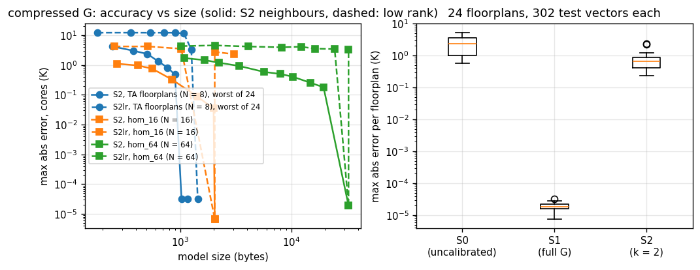

# P2-1: The steady-state predictor (S0, S1, S2)

**Question.** How accurate, fast and small is the calibrated steady predictor, on unseen power
inputs, against HotSpot? And how far can the model be shrunk for larger core counts?

**Reproduce.** `bash experiments/run.sh P2-1_steady_predictor` (needs P1-1; the test set is shared
with P1-3, about 5 min if cached).

## Setup

- Test set (never used in calibration): TA nominal, max and 300 random power vectors per floorplan
  (big 10–20 W, little 5–10 W), on all 23 TA floorplans and HET-A: 7,248 HotSpot steady runs
  (grid 64×64). Errors are over cores.
- Models: **S0** (uncalibrated power blurring, P1-3), **S1** (influence matrix from 8 runs, P1-1),
  **S2** (compressed G: each output keeps its k nearest inputs, all others share one per-output
  package term), **S2-lr** (rank-r approximation of G).
- Prediction time: median of 10,000 single-vector calls, one thread, Python + NumPy overhead
  included (`src/ltp/bench.py`). HotSpot: 0.24 s per steady run (P0-4).
- Size: bytes of coefficients (float64 unless stated). The S1 numbers include rows for the FILL
  blocks (the TA floorplans have 11–25 output blocks); cores only, S1 is 8×8 = 512 B.
- S2 on larger floorplans: HOM-16 (4×4 cores, 8×8 mm) and HOM-64 (8×8 cores, 16×16 mm), 2 W
  nominal per core, 100 random test vectors each.

## Results

**All 24 floorplans:**

| model | mean abs error | worst max error | worst peak error | hottest core right (worst floorplan) | time per prediction | size | speed-up vs HotSpot |
|---|---|---|---|---|---|---|---|
| S0 power blurring (uncalibrated) | 0.77 K | 5.2 K | 4.7 K | 40 % | 2.5 µs | 928 B | 94,000× |
| **S1 influence matrix** | **6×10⁻⁶ K** | **3×10⁻⁵ K** | 3×10⁻⁵ K | **100 %** | **2.6 µs** | **928 B** (512 B cores only) | **91,000×** |
| S1, float32 coefficients | 6×10⁻⁶ K | 3×10⁻⁵ K | 3×10⁻⁵ K | 100 % | 3.1 µs | 464 B | 77,000× |
| S1, batch of 302 vectors per call | same | same | same | 100 % | 0.06 µs per vector | 928 B | 4,000,000× |
| S2, k = 2 | 0.20 K | 2.3 K | 2.3 K | 78 % | 8.0 µs | 507 B | 30,000× |
| S2-lr, rank 2 | 3.1 K | 12.1 K | 6.3 K | 29 % | 3.4 µs | 360 B | 71,000× |

S1 mean abs error per style: 5.9, 6.5, 7.4 and 6.4 ×10⁻⁶ K (Style_1–4), 2.3×10⁻⁶ K (HET-A).

**Compression on the TA floorplans** (N = 8; worst of 24):

| k (S2) | size | worst max error | | rank (S2-lr) | size | worst max error |
|---|---|---|---|---|---|---|
| 0 | 246 B | 4.2 K | | 1 | 180 B | 12.1 K |
| 2 | 507 B | 2.3 K | | 2 | 360 B | 12.1 K |
| 4 | 768 B | 0.82 K | | 4 | 720 B | 12.1 K |
| 5 | 899 B | 0.47 K | | 7 | 1,260 B | 3.3 K |
| 6 | 1,029 B | exact | | 8 | 1,440 B | exact |

**Compression for larger core counts** (max abs error over 100 test vectors):

| floorplan | full S1 | S2, k = 4 | S2, k = 8 | S2, k = 16 | S2, k = 32 | best low rank |
|---|---|---|---|---|---|---|
| HOM-16 (N = 16) | 2,048 B, exact | 848 B, 0.32 K | 1,424 B, 0.088 K | | | 3,072 B, 2.3 K |
| HOM-64 (N = 64) | 32,768 B, exact | 3,392 B, 0.93 K | 5,696 B, 0.59 K | 10,304 B, 0.41 K | 19,520 B, 0.18 K | 32,768 B, 3.3 K |

## Conclusion

- **S1 meets every target in the plan (§1.4) by a wide margin.** It is exact to HotSpot's printed
  precision (3×10⁻⁵ K worst, against a 0.1 K target), always finds the hottest core, takes 2.6 µs
  per prediction (target ≤ 20 µs; HotSpot takes 0.24 s) and is 512–928 B (target ≤ 5 kB). Batch
  prediction brings the cost down to 60 ns per power vector.
- **float32 is enough**: half the size, no measurable loss (the coefficients are ~1 K/W and the
  error stays at 3×10⁻⁵ K).
- **Calibration is what makes the difference:** S0 has the same size and speed but is 0.8 K off on
  average and 5 K at worst (P1-3).
- **For 8 cores, compression is pointless**: the full G is already under 1 kB, and S2 only saves
  a few hundred bytes at the cost of up to 2 K. It matters for larger chips: on HOM-64, S2 with
  k = 8 neighbours cuts the model from 32.8 kB to 5.7 kB (5.8×) for 0.6 K worst error, and k = 32
  gives 0.18 K at 19.5 kB. This is the plan's stretch goal "model-size reduction for larger core
  counts".
- **Low rank does not work for thermal coupling**: heat spreads locally, so G is close to
  "diagonal plus a constant", not low-rank. S2's "nearest neighbours plus a shared package term"
  matches that structure.
- An earlier S2 version used one global package term (the smallest coupling) instead of a
  per-output average; it was up to 17 K off on HOM-64. The per-output average is exact for uniform
  power and was kept.

## Files

- `results/all_results.csv` (every floorplan × model), `results/summary.csv`,
  `results/per_style.csv`, `results/s2_ta.csv`, `results/s2_large.csv`,
  `results/steady_accuracy.png`, `results/summary.json`, `results/log.txt`.
