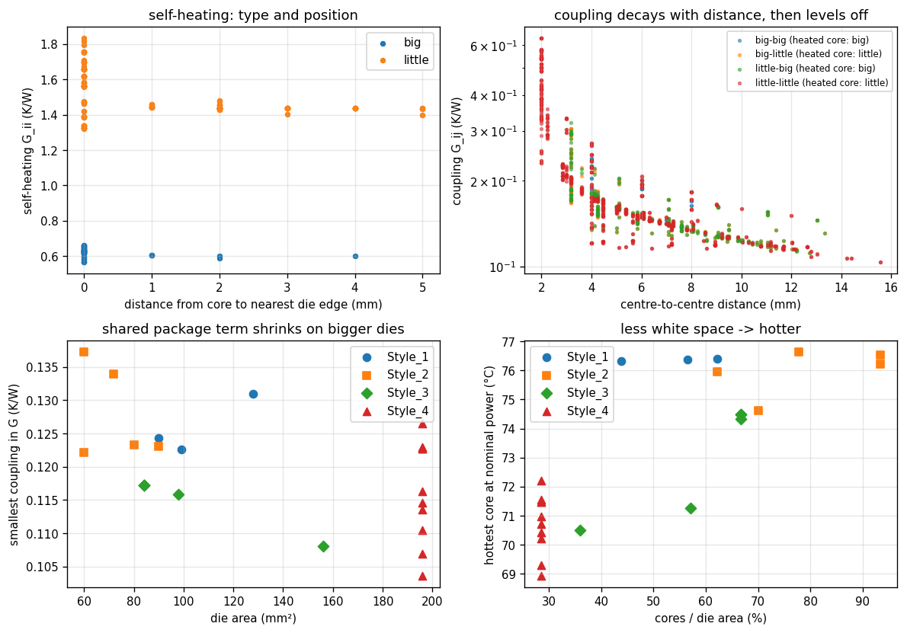

# P2-2: Layout effects across the 23 TA floorplans

**Question.** All 23 TA floorplans have the same cores and the same power, yet P1-3 showed their
coefficients cannot be swapped. *Why* do the coefficients differ? And does white space really
keep the chip cooler, as the TA's README says?

**Reproduce.** `bash experiments/run.sh P2-2_layout_effects` (seconds; reads P1-1's calibrated G,
no new HotSpot runs).

## Results

**How much the coefficients vary across floorplans:**

| quantity | min | max | max / min |
|---|---|---|---|
| self-heating G_ii, big cores (K/W) | 0.565 | 0.659 | 1.17 |
| self-heating G_ii, little cores (K/W) | 1.32 | 1.83 | 1.39 |
| coupling G_ij, all core pairs (K/W) | 0.104 | 0.635 | 6.1 |
| shared package term (smallest coupling per floorplan, K/W) | 0.104 | 0.137 | 1.32 |
| hottest core at TA nominal power (°C) | 68.9 | 76.6 | |

**Edge vs interior cores** (self-heating, mean):

| core type | on the die edge | ≥ 1 mm from the edge |
|---|---|---|
| big | 0.623 K/W (40 cores) | 0.600 K/W (6 cores) |
| little | 1.555 K/W (77 cores) | 1.439 K/W (59 cores) |

**Correlations over the 23 floorplans:**

| pair | correlation |
|---|---|
| hottest core vs fraction of die covered by cores | +0.83 |
| hottest core vs die area | −0.86 |
| shared package term vs die area | −0.49 |
| self-heating vs distance to die edge (big / little) | −0.29 / −0.42 |

## Conclusion

- **Three geometric effects explain why G differs between floorplans:**
  1. *Edges.* A core on the die edge cannot spread heat outwards, so it heats itself more: little
     cores +8 % on average and up to +27 % (1.83 against 1.44 K/W). Most TA cores sit on an
     edge (117 of 182).
  2. *Distance.* Coupling falls steeply over the first 4 mm (0.63 → 0.15 K/W) and then levels
     off. Which cores are neighbours therefore decides most of the off-diagonal terms, and
     neighbour relations differ in every layout.
  3. *Die size.* Every core also warms the shared spreader and sink. That "package term" (the
     floor of the coupling curve, 0.10–0.14 K/W) is smaller on larger dies, which spread heat
     into the spreader over a larger area.
- **The TA's remark holds: white space keeps the chip cooler.** Peak temperature at the same
  88 W rises with core coverage (r = +0.83) and falls with die area (r = −0.86): about 69–72 °C on
  the sparse 14×14 mm Style_4 dies against about 76–77 °C on the dense Style_1/2 dies.
- **Placement matters on its own too.** The 10 Style_4 floorplans have the same die, cores and
  power, and their hottest core still ranges from 68.9 to 72.2 °C, depending on which cores are
  clustered or on an edge.
- These are exactly the effects a per-core-type or "average floorplan" model cannot know, which
  is why calibration per floorplan (8 HotSpot runs) wins in P1-3.

## Files

- `results/self_heating.csv` (every core: type, distance to edges, G_ii),
  `results/coupling.csv` (every core pair: distance, G_ij),
  `results/per_floorplan.csv` (die, white space, package term, temperatures),
  `results/summary.json`, `results/layout_effects.png`.
