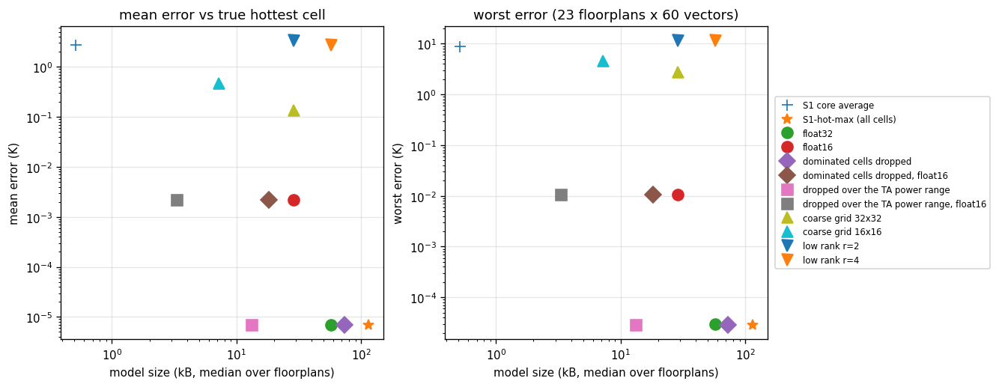

# P2-3: Hot spots inside cores (S1-hot-max) and compressing its matrix

**Question.** P0-3 found the hottest grid cell inside a core is several K above the core's
average, which is all S1 predicts. Can the calibrated model predict each core's *hottest spot*
instead, and how small can that model be made? (Scope risk: "block-level model may hide hot spots
inside large cores.")

**Reproduce.** `bash experiments/run.sh P2-3_hot_spots` (needs the P1-1 calibration; about 5 min for
the test set once that is cached).

## Setup

- Floorplans: the 23 TA floorplans (8 cores each), HotSpot grid model 64 x 64.
- Calibration: no new runs. The P1-1 unit runs (1 W in one core each) also write 64 x 64 maps, so
  the rise of *every grid cell* per watt of every core is known: G_cells (4,096 x 8).
- **S1-hot-max** keeps the rows of G_cells for every cell inside a core (1,134-3,823 cells per
  floorplan) and predicts, for each core, the largest of those cells:
  `T_hot(core c) = T_amb + max over cells q inside c of (G_cells[q] . P)`.
  HotSpot is linear, so this is exact. The matrix is 8 numbers per cell: 73-245 kB in float64
  (median 115 kB). The size comes from the fine grid, not from the number of cores.
- Compressions of that matrix:
  - **float32 / float16** storage (float16 values are computed in float32).
  - **Drop dominated cells.** If another cell of the same core has every one of its 8 coefficients
    at least as large, a cell can never be the hottest when power is non-negative. Dropping it
    changes nothing (exact for any P >= 0).
  - **Drop cells dominated over the TA power range.** The same test with each core's power between
    its minimum and maximum (big 10-20 W, little 5-10 W): cell q is dropped if some other cell q'
    of the same core is at least as hot for every power vector in that range,
    `sum_j min(d_j lo_j, d_j hi_j) >= 0` with `d = G_cells[q'] - G_cells[q]`. Exact as long as every
    core stays within its range.
  - **Coarser grid:** keep every 2nd or 4th cell in each direction (32 x 32, 16 x 16).
  - **Low rank:** truncated SVD of the matrix.
- Test: 60 random power vectors per floorplan (each core uniform in its range; 1,380 HotSpot runs
  with grid maps). The truth for each core is the hottest cell whose centre lies inside it. Models
  never see these vectors.

## Results

All 23 TA floorplans x 60 vectors; size is the median over floorplans.

| model | size | mean error | worst error | hottest core right (worst floorplan) |
|---|---|---|---|---|
| S1 core average | 512 B | 2.73 K | 8.96 K | 50 % |
| **S1-hot-max (all cells)** | 115 kB | 0.000007 K | 0.00003 K | 100 % |
| float32 | 57 kB | 0.000007 K | 0.00003 K | 100 % |
| float16 | 29 kB | 0.0022 K | 0.011 K | 98 % |
| dominated cells dropped | 73 kB | 0.000007 K | 0.00003 K | 100 % |
| dominated cells dropped, float16 | 18 kB | 0.0022 K | 0.011 K | 98 % |
| dropped over the TA power range | 13 kB | 0.000007 K | 0.00003 K | 100 % |
| **dropped over the TA power range, float16** | **3.3 kB** | **0.0022 K** | **0.011 K** | **98 %** |
| coarse grid 32 x 32 | 29 kB | 0.14 K | 2.8 K | 95 % |
| coarse grid 16 x 16 | 7.2 kB | 0.47 K | 4.7 K | 85 % |
| low rank r = 2 | 29 kB | 3.4 K | 11.4 K | 10 % |
| low rank r = 4 | 58 kB | 2.8 K | 11.6 K | 15 % |

Cells kept per floorplan: dominated cells dropped 574-2,535; dropped over the TA power range
51-1,118 (the float16 version is 0.8-17.9 kB). The 98 % for float16 means a few near-ties between
cores (within 0.01 K) are ordered differently.

## Conclusion

- **The core average underestimates the real peak by 2.7 K on average and up to 9 K.** A DTM limit
  applied to S1's numbers would let the true hot spot run that much hotter. The scope risk is real
  and measured.
- **S1-hot-max (all cells) predicts the hot spot exactly** (0.00003 K worst, HotSpot's output
  precision), with no extra HotSpot runs, for 115 kB.
- **It compresses about 35x with almost no loss.** Dropping the cells that can never be the
  hottest within the TA power range is exact and leaves 13 kB, and float16 storage brings that to
  **3.3 kB at 0.002 K mean and 0.011 K worst error**.
- **Lossy shortcuts cost much more accuracy.** A coarser grid misses the peak (2.8 K worst at 32 x 32).
  Low rank fails, as for G in P2-1: it is worse than the plain core average.
- **Limit:** the range-based dropping is exact only while every core's power stays within the TA
  range. For power above the range (P4-1 tests up to 3x), use the "dominated cells dropped" version
  (73 kB, or 18 kB in float16), which is exact for any non-negative power.
- Recommendation for the product: ship S1 (core averages) plus S1-hot-max with the range-based
  dropping in float16 (about 3 kB), and let DTM use the hot-spot estimate.

## Files

- `run.py`; `results/all_results.csv` (per floorplan and model, including prediction times),
  `results/summary.csv`, `results/summary.json`, `results/size_vs_error.png`, `results/log.txt`.
