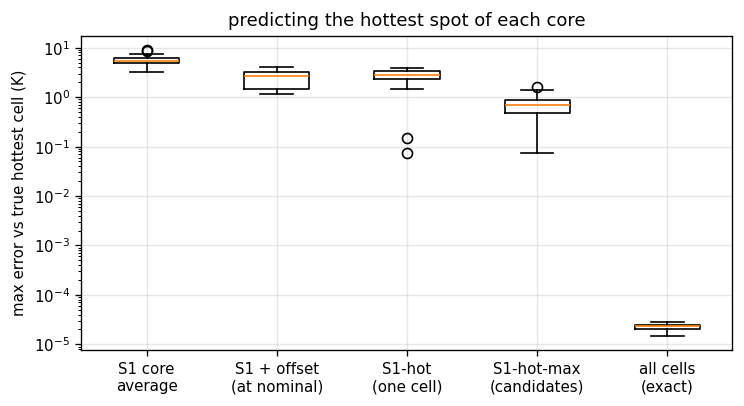

# P2-3: Hot spots inside cores (S1-hot)

**Question.** P0-3 found the hottest grid cell inside a core is 3–4 K above the core's average,
which is all S1 predicts. Can the calibrated model predict each core's *hottest spot* instead?
(Scope risk: "block-level model may hide hot spots inside large cores.")

**Reproduce.** `bash experiments/run.sh P2-3_hot_spots` (needs P1-1; about 5 min for the test set).

## Setup

- Calibration: no new runs. The P1-1 unit runs also produced 64×64 maps, so the rise of *every
  cell* per watt of every core is known: G_cells (4,096 × 8).
- Truth: 60 random power vectors per TA floorplan (1,380 HotSpot runs with maps); for each core,
  the hottest cell whose centre lies inside it.
- Predictors of each core's hottest spot:

| model | what it predicts | size (median) |
|---|---|---|
| S1 core average | the core average (no correction) | 512 B |
| S1 + offset | average plus a constant per core (hot spot − average at nominal power) | 576 B |
| S1-hot | one fixed cell per core: the hottest at nominal power | 512 B |
| S1-hot-max | the max over a few candidate cells per core (the hottest cell when each single core is heated, and at nominal power; 3–9 per core, 6.1 on average over the 23 TA floorplans) | 3.1 kB |
| all cells | the max over every cell of the core (exact, as a reference) | 115 kB |

## Results

Errors against the true hottest cell of each core (all 23 TA floorplans):

| model | size | mean abs error | worst max error | worst error in the chip's peak | hottest core right (worst floorplan) |
|---|---|---|---|---|---|
| S1 core average | 512 B | 2.73 K | 8.96 K | 4.95 K | 50 % |
| S1 + offset (nominal) | 576 B | 0.59 K | 4.11 K | 1.32 K | 82 % |
| S1-hot (one cell) | 512 B | 0.29 K | 3.97 K | 3.56 K | 68 % |
| **S1-hot-max (candidate cells)** | **3.1 kB** | **0.078 K** | **1.6 K** | **0.72 K** | **90 %** |
| all cells (exact) | 115 kB | 7×10⁻⁶ K | 3×10⁻⁵ K | 3×10⁻⁵ K | 100 % |

**The hot spot moves:** the hottest cell of a core is a different cell than at nominal power in
61 % of (core, test vector) cases (87 % on the worst floorplan).

Per style, mean / worst error (K): S1 core average 2.35 / 5.6 (Style_1), 2.63 / 9.0 (Style_2),
2.42 / 6.3 (Style_3), 3.05 / 6.4 (Style_4); S1-hot-max 0.12 / 0.81, 0.09 / 0.67, 0.06 / 0.86,
0.07 / 1.6.

## Conclusion

- **The core average underestimates the real peak by 2.7 K on average and up to 9 K.** A DTM
  limit applied to S1's numbers would let the true hot spot run that much hotter. The scope risk
  is real and measured.
- **A constant offset or a single fixed cell is not enough,** because the hot spot moves: a hot
  neighbour pulls it towards the shared edge. Both reduce the average error (to 0.3–0.6 K) but
  leave 4 K worst cases.
- **S1-hot-max fixes it cheaply.** Every cell is still exactly linear in power, and the maximum
  of a few linear functions captures the moving hot spot: 0.08 K mean, 1.6 K worst, 90 %
  hottest-core accuracy, for about 3 kB and no extra HotSpot runs. Exact hot spots (all cells) are
  possible too, at 115 kB, still far below any learned model's size.
- Recommendation for the product: ship S1 (core averages) plus the S1-hot-max candidate rows, and
  let DTM use the hot-spot estimate.

## Files

- `results/all_results.csv`, `results/summary.csv`, `results/hot_cell_movement.csv`,
  `results/hot_spot_error.png`, `results/summary.json`, `results/log.txt`.
