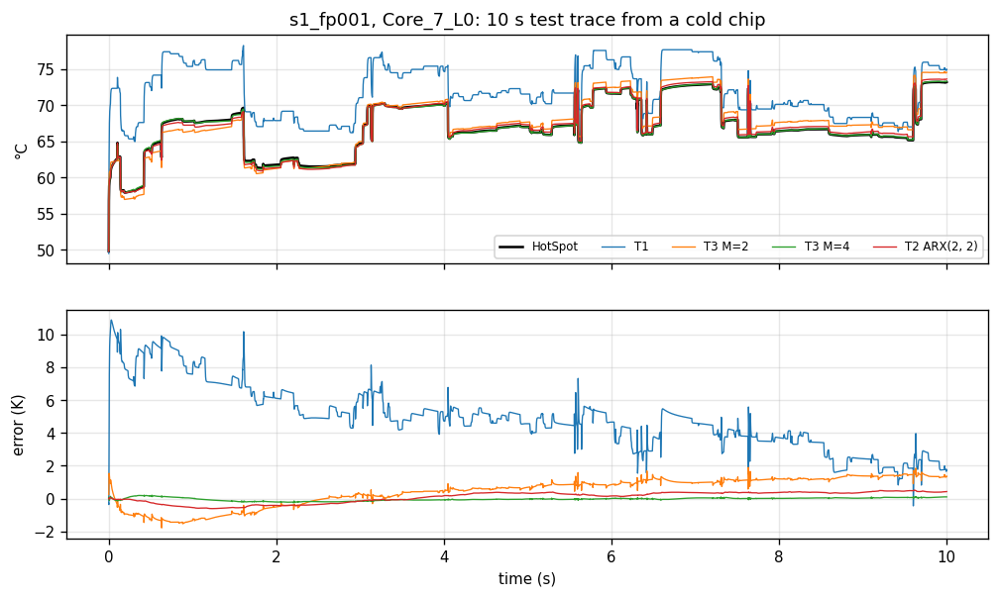

# P3-1: The transient predictor, open loop

**Question.** Given only a power trace (and a cold chip at the start, like HotSpot), how well do
the calibrated transient models reproduce HotSpot's temperature trace? How fast and small are
they?

**Reproduce.** `bash experiments/run.sh P3-1_transient_predictor` (needs P1-1 and P1-2; about
30 min the first time, mostly EV6's calibration and the test traces).

## Setup

- Models (calibrated per floorplan, never on test data): **T1** (one time constant per output),
  **T3** (M = 2…6 shared time constants), both from P1-1's step runs; **T2** ARX (2,2) all blocks,
  calibrated on the first 20 s of P1-2's excitation trace (main subset only).
- Every model starts from a cold chip and sees only the power. HotSpot grid 64×64, Δt = 1 ms.
- Test sets:
  - *short*: a 2 s phase trace on each of the 24 floorplans (23 TA + HET-A);
  - *long*: two 10 s phase traces on each main-subset floorplan (shared with P1-2);
  - *gcc*: EV6 (30 blocks, calibrated the same way: 90 runs) with HotSpot example1's real gcc
    power trace, each 10 ms row held for 10 steps (1 s).
- Errors over cores. Time per step: median over a 2,000-step run, one thread.
  HotSpot: about 5.5 ms per step on an idle machine (P0-4).

## Results

| test | model | mean abs error | worst max error | worst peak error | hottest core right (worst) | time per step | size |
|---|---|---|---|---|---|---|---|
| short (24 fp) | T1 | 7.25 K | 14.6 K | 14.4 K | 83 % | 1.5 µs | 1.0 kB |
| | T3 M = 2 | 0.92 K | 2.9 K | 2.7 K | 77 % | 3.0 µs | 1.9 kB |
| | T3 M = 3 | 0.19 K | 1.1 K | 0.90 K | 94 % | 3.0 µs | 2.8 kB |
| | **T3 M = 4** | **0.090 K** | **0.30 K** | 0.27 K | 96 % | **3.1 µs** | **3.7 kB** |
| | T3 M = 5 | 0.022 K | 0.13 K | 0.092 K | 99 % | 3.1 µs | 4.7 kB |
| | T3 M = 6 | 0.0093 K | 0.13 K | 0.059 K | 99 % | 3.2 µs | 5.6 kB |
| | T2 ARX (main subset) | 0.19 K | 0.57 K | 0.52 K | 100 % | 5.4 µs | 6.2 kB |
| long (4 fp × 2) | T1 | 4.64 K | 14.3 K | 12.5 K | 95 % | 1.5 µs | 1.1 kB |
| | T3 M = 2 | 0.72 K | 2.7 K | 2.3 K | 92 % | 3.0 µs | 2.0 kB |
| | T3 M = 3 | 0.13 K | 1.1 K | 0.80 K | 99 % | 3.1 µs | 3.0 kB |
| | **T3 M = 4** | **0.062 K** | **0.31 K** | 0.30 K | 99 % | **3.1 µs** | 4.0 kB |
| | T3 M = 5 | 0.016 K | 0.098 K | 0.081 K | 98 % | 3.2 µs | 5.0 kB |
| | T3 M = 6 | 0.009 K | 0.064 K | 0.058 K | 100 % | 3.2 µs | 6.0 kB |
| | T2 ARX (2,2) | 0.21 K | 1.03 K | 1.02 K | 100 % | 5.4 µs | 6.2 kB |
| gcc (EV6) | T1 | 4.33 K | 11.2 K | 10.3 K | 100 % | 1.7 µs | 7.4 kB |
| | T3 M = 4 | 0.073 K | 1.31 K* | 0.16 K | 100 % | 4.4 µs | 28.8 kB |
| | T3 M = 6 | 0.015 K | 2.03 K* | 0.026 K | 100 % | 5.3 µs | 43.2 kB |

\* On EV6 the worst error is in the very first 1 ms step from a cold chip, on tiny 0.7 mm² blocks
(Bpred, DTB) whose silicon time constant is below 1 ms. From step 20 on, the worst error is
0.21 K (M = 4) and 0.20 K (M = 6).

## Conclusion

- **T3 is the transient predictor to ship.** With M = 4 it follows HotSpot within 0.06–0.09 K on
  average and 0.3 K at worst on all 24 floorplans (plan target: ≤ 0.5 K mean, ≤ 1 K peak), for
  3.7–4 kB (target ≤ 50 kB) and 3.1 µs per step (target ≤ 50 µs): about 1,800× faster than
  HotSpot's 5.5 ms per step. M = 6 cuts the error by another 5–10× for 1.6 kB more.
- **Accuracy grows smoothly with M** (2 → 6: 0.9 → 0.01 K mean). That is the accuracy/size knob
  used in P3-3. Time per step hardly changes with M; it is dominated by Python overhead.
- **T1 is not a usable transient model** (5–7 K mean, 14 K worst): one time constant per core
  cannot be fast and slow at once (see the figure: it overshoots early and lags later).
- **T2 (ARX) works but is worse than T3** (0.2 K mean, up to 1 K) and needs a long calibration
  trace. Its strength is forecasting from sensors (P3-2).
- **The method carries over to a real workload and a different floorplan** (EV6, 30 blocks, real
  gcc trace): 0.07 K mean error with M = 4. The only weak point is the first millisecond after
  a cold start on very small blocks.

## Files

- `results/all_results.csv` (every floorplan × test trace × model), `results/summary.csv`,
  `results/trace_example.png`, `results/summary.json`, `results/log.txt`.
