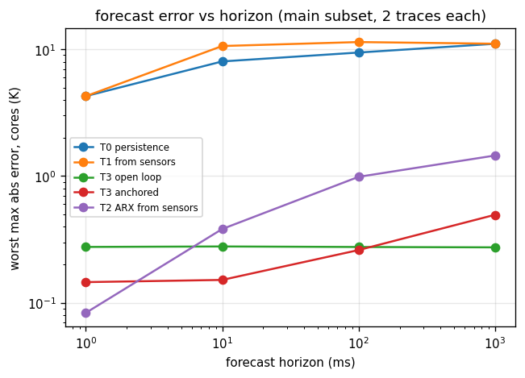

# P3-2: Forecasting h steps ahead from sensor readings

**Question.** A DTM controller reads the on-chip temperature sensors every interval and wants to
know the temperature h steps ahead for the power it plans to apply. How does the forecast error
grow with the horizon, for each model, and how does it compare with doing nothing ("the
temperature stays as it is")?

**Reproduce.** `bash experiments/run.sh P3-2_forecast_horizon` (minutes; uses P1-1/P1-2's caches).

## Setup

- Main subset, the two 10 s test traces each (P1-2), Δt = 1 ms. HotSpot's core temperatures
  stand in for the sensors.
- At 352 start points per trace (every 25 ms), each model gets the sensor readings up to that
  point and the planned power for the next h steps, and forecasts the core temperatures h steps
  ahead, for h = 1, 10, 100, 1,000 (1 ms to 1 s).

| model | uses sensors | how |
|---|---|---|
| T0 persistence | yes | T(k0 + h) = T(k0) |
| T1 from sensors | yes | first-order lag started at the measured temperatures |
| T3 open loop (M = 4) | no | T3 on the power history alone (as in P3-1) |
| **T3 anchored (M = 4)** | yes | T3 on the power history, shifted to equal the sensors at k0 (`Predictor.forecast`) |
| T2 ARX from sensors | yes | cores-only ARX (2,2), started from the last two measured temperatures |

## Results

Over 4 floorplans × 2 traces × 352 start points × 8 cores:

| model | horizon | mean abs error | 99th percentile (worst trace) | max (worst trace) |
|---|---|---|---|---|
| T0 persistence | 1 ms | 0.013 K | 0.32 K | 4.3 K |
| | 10 ms | 0.11 K | 4.2 K | 8.0 K |
| | 100 ms | 0.69 K | 7.9 K | 9.5 K |
| | 1 s | 2.7 K | 10.4 K | 11.1 K |
| T1 from sensors | 1 ms | 0.88 K | 2.6 K | 4.3 K |
| | 10 ms / 100 ms / 1 s | 3.6 / 4.7 / 4.2 K | 9.0 / 9.5 / 8.5 K | 10.6 / 11.4 / 11.1 K |
| T3 open loop | any | 0.06 K | 0.25 K | 0.28 K |
| **T3 anchored** | 1 ms | **0.0009 K** | 0.021 K | 0.15 K |
| | 10 ms | **0.0044 K** | 0.043 K | 0.15 K |
| | 100 ms | 0.017 K | 0.19 K | 0.26 K |
| | 1 s | 0.055 K | 0.43 K | 0.50 K |
| T2 ARX from sensors | 1 ms | 0.0013 K | 0.017 K | 0.083 K |
| | 10 ms | 0.015 K | 0.14 K | 0.38 K |
| | 100 ms | 0.10 K | 0.66 K | 0.99 K |
| | 1 s | 0.42 K | 1.3 K | 1.5 K |

Cost of one `Predictor.forecast` call: 35 µs for 10 steps ahead, 318 µs for 100 (the current
implementation steps through the horizon in Python; a closed-form version for constant planned
power, as used in P6-2, is a few µs).

## Conclusion

- **"No model" is not an option for DTM.** Persistence is fine on average at 1 ms but is up to
  4.3 K wrong even 1 ms ahead, and 8 K at 10 ms: a power step heats a core within milliseconds
  (P1-1: ~70 % of self-heating appears within 10 ms). That is exactly when DTM needs to act.
- **T3 anchored on the sensors is the best forecaster from 10 ms to 1 s**: below 0.005 K on
  average and 0.15 K at worst over the next 10 ms, and 0.5 K at worst over a whole second.
  Anchoring removes most of T3's open-loop bias at short horizons. At 1 s, anchoring is slightly
  worse in the worst case than not anchoring (0.50 against 0.28 K): the current offset is held
  constant over the horizon, but in reality it fades.
- **ARX from sensors is the most accurate for one step (1 ms)**, since it uses the actual recent
  temperatures, but its error grows fastest with the horizon.
- **T1 is worse than doing nothing**: it is calibrated to one time constant, so starting it from
  the sensors makes it relax at the wrong speed.
- For DTM (P6-2), with decisions every 10 ms looking 20 ms ahead, T3 anchored is the right choice.

## Files

- `results/all_results.csv` (every floorplan × trace × model × horizon), `results/summary.csv`,
  `results/error_vs_horizon.png`, `results/summary.json`, `results/log.txt`.
