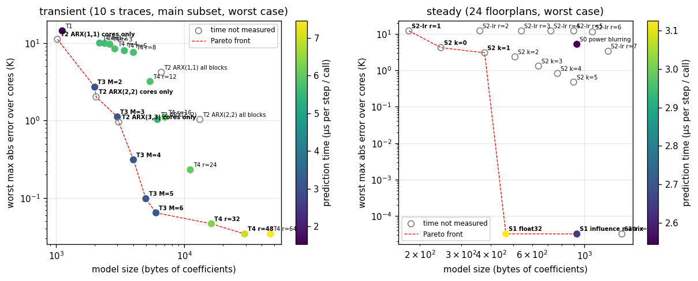

# P3-3: Accuracy vs model size vs prediction time

**Question.** The problem statement asks for three metrics: accuracy, prediction time and model
size. Across all the models we built, what is the trade-off between them, and which models are
on the Pareto front (no other model is both smaller and more accurate)?

**Reproduce.** `bash experiments/run.sh P3-3_pareto` (seconds; it only collects the results of
P1-2, P2-1, P3-1 and P3-4, so run those first).

## Data

- Transient: worst max error on the long test traces (main subset, two 10 s traces each, open
  loop from a cold chip). T1, T3 (M = 2…6) and T2 ARX (2,2) from P3-1; the other ARX variants
  from P1-2 (20 s calibration trace, prediction time not measured; unstable ones left out);
  T4 (r = 1…64) from P3-4.
- Steady: worst max error over 24 floorplans (P2-1). S0, S1 (float64 and float32), S2 with
  k = 0…5, S2-lr with rank 1…7.
- Size: bytes of coefficients. Time: µs per step (transient) or per call (steady), one thread.

## Results

**Transient Pareto front** (bold in the plot):

| model | size | worst max error | mean abs error | time per step |
|---|---|---|---|---|
| T2 ARX (1,1) cores only | 1.0 kB | 11.1 K | 3.4 K | – |
| T2 ARX (2,2) cores only | 2.0 kB | 2.0 K | 0.82 K | – |
| T3 M = 2 | 2.0 kB | 2.7 K | 0.72 K | 3.0 µs |
| T2 ARX (3,3) cores only | 3.1 kB | 0.95 K | 0.32 K | – |
| T3 M = 3 | 3.0 kB | 1.1 K | 0.13 K | 3.1 µs |
| **T3 M = 4** | **4.0 kB** | **0.31 K** | **0.062 K** | **3.1 µs** |
| T3 M = 5 | 5.0 kB | 0.098 K | 0.016 K | 3.2 µs |
| T3 M = 6 | 6.0 kB | 0.064 K | 0.009 K | 3.2 µs |
| T4 r = 32 | 16.2 kB | 0.047 K | 0.0074 K | 6.3 µs |
| T4 r = 48 | 29.4 kB | 0.034 K | 0.0003 K | 7.0 µs |

Off the front: T1 (1.1 kB, 14 K), T4 with r ≤ 24 (2–11 kB, 0.23–10 K), ARX on all blocks
(6.6–13 kB, ≥ 1 K).

**Steady Pareto front:** S2-lr rank 1 (180 B, 12 K), S2 k = 0 (246 B, 4.2 K), S2 k = 1 (377 B,
3.0 K), **S1 float32 (464 B, 3×10⁻⁵ K)**; S1 float64 (928 B) is equally accurate.

Prediction time hardly depends on the model in this range: 2.5–3.2 µs per steady call and
3–7 µs per transient step, dominated by Python/NumPy call overhead. HotSpot needs 0.24 s per
steady solution and about 5.5 ms per transient step (P0-4).

## Conclusion

- **Steady state has no real trade-off:** S1 is exact and needs 464 B (float32). Compression (S2)
  only pays off for many cores (P2-1: HOM-64).
- **Transient: T3 is the front from 2 to 6 kB.** Each extra time constant costs 1 kB (N × n_out
  numbers) and divides the worst error by about 2–4. **T3 with M = 4 (4 kB, 0.31 K worst, 3 µs
  per step) is the recommended default**; M = 6 when 0.06 K is wanted.
- **T4 (exact model + balanced truncation) only wins below 0.05 K**, from about 16 kB. At equal
  size, T3 is more accurate: T3 shares time constants across all core pairs, while T4 needs a
  full state matrix. T4 is the "how small can an exact model get" reference the plan asked for.
- **Cores-only ARX is surprisingly small** (2–3 kB) and reaches 1–2 K. That is not competitive
  for open-loop prediction, but it uses only sensor data, which is why it appears in P3-2.
- All models are 1,000–100,000× faster than HotSpot, so model choice is about accuracy and size,
  not time.

## Files

- `results/transient_points.csv`, `results/steady_points.csv` (every point, with a `pareto` flag),
  `results/pareto.png`, `results/summary.json`.
