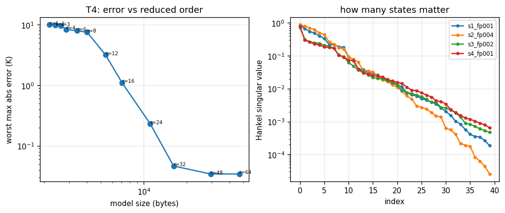

# P3-4 [OPT]: Exact state space from HotSpot's matrices, and model-order reduction (T4)

**Question.** T1–T3 are fitted to HotSpot's outputs. Can we instead take HotSpot's own thermal
network, which is exact by definition, and shrink it until it is small? How small can an
(almost) exact model get, and how does it compare with T3?

**Reproduce.** Build the dump variant once:
`LTP_DUMP_BUILD=1 HOTSPOT_LTP=~/projects/HotSpot-dump bash setup/build_hotspot_ltp.sh`, then
`bash experiments/run.sh P3-4_state_space_T4` (about 5 min).

## Method

1. **Export the exact system.** A debug patch (`setup/patch_dump.py`, separate build) makes
   HotSpot write its grid model's sparse conductance matrix G, its capacitances C and the node
   power vector P at the first transient step. HotSpot's transient step is backward Euler,
   (C/h + G) T⁺ = (C/h) T + P, so with x = T − T_amb and B[:, j] = P(1 W in core j) − P(0 W):
   **C ẋ = −G x + B p, y = W x**, where W is HotSpot's cell-to-block averaging (P0-3/gridmap).
   For a TA floorplan: 16,396 states (4 layers × 64 × 64 cells + 12 package nodes); G is exactly
   symmetric.
2. **Check it.** Simulate the full system with backward Euler (sparse LU) on the 10 s test trace
   and compare with HotSpot.
3. **Reduce it**, in three steps:
   - *Modal truncation:* the 200 slowest modes of the symmetric pencil (G, C) (shift-invert
     `eigsh`); time constants from 0.76 ms to 8.1 s are kept.
   - *Balanced truncation* of that 200-state system to r states (square-root method), then
     backward Euler at h = 1 ms, exactly like HotSpot.
   - *Fast-part filter:* everything dropped becomes one first-order filter per (output, input)
     pair. Its gain makes the steady state exact and its pole makes the first 1 ms step exact.
     Without it (a plain static correction, the usual approach) the worst error stalled at
     3.3 K for every r: modes with time constants of about 0.1–1 ms are not instantaneous at
     1 ms steps.
4. **Test** r = 1…64 on the two 10 s test traces per floorplan (main subset), against HotSpot.

## Results

**Checks** (per floorplan):

| floorplan | states | steady gain vs S1 (P1-1) | full model vs HotSpot (10 s trace) | 200 modes + filter vs HotSpot | full model, ms per step | reduction time |
|---|---|---|---|---|---|---|
| s1_fp001 | 16,396 | 5×10⁻⁷ K/W | **1.2×10⁻⁶ K** | 0.014 K | 6.4 | 15 s |
| s2_fp004 | 16,396 | 5×10⁻⁷ K/W | **1.2×10⁻⁶ K** | 0.006 K | 6.7 | 12 s |
| s3_fp002 | 16,396 | 5×10⁻⁷ K/W | **1.1×10⁻⁶ K** | 0.026 K | 6.8 | 11 s |
| s4_fp001 | 16,396 | 5×10⁻⁷ K/W | **1.0×10⁻⁶ K** | 0.034 K | 8.2 | 11 s |

**Reduced models** (worst over 4 floorplans × 2 traces; size includes the fast-part filter):

| order r | size | mean abs error | worst max error | time per step |
|---|---|---|---|---|
| 1–8 | 2.2–4.0 kB | 2.8–4.0 K | 7.5–10 K | 5.7 µs |
| 12 | 5.4 kB | 0.84 K | 3.2 K | 5.8 µs |
| 16 | 7.0 kB | 0.29 K | 1.1 K | 6.0 µs |
| 24 | 11.1 kB | 0.044 K | 0.23 K | 6.0 µs |
| **32** | **16.2 kB** | **0.0074 K** | **0.047 K** | 6.3 µs |
| 48 | 29.4 kB | 0.0003 K | 0.034 K | 7.0 µs |
| 64 | 46.8 kB | 0.00005 K | 0.034 K | 7.5 µs |
| *T3 M = 4 / M = 6 (P3-1)* | *4.0 / 6.0 kB* | *0.062 / 0.009 K* | *0.31 / 0.064 K* | *3.1 µs* |

## Conclusion

- **The exact model is confirmed.** Rebuilt from HotSpot's matrices, it reproduces HotSpot to
  10⁻⁶ K (the output precision) and its steady gain equals the calibrated G to 5×10⁻⁷ K/W. This
  independently confirms that S1 is exact and that HotSpot is a linear state-space system.
- **About 30 states are enough** for errors below 0.05 K: the Hankel singular values fall by
  three orders of magnitude within the first 30–40 states. The worst error levels off at about
  0.03 K above r = 48: what is left are the dropped fast modes, which the one-pole filter only
  approximates.
- **T3 is the better product, T4 the better reference.** At the same size T3 is more accurate
  (4 kB: 0.31 K against 3–8 K for T4), because shared time constants are a very compact
  description. T4 reaches near-exact mean errors (5×10⁻⁵ K) that T3 cannot. It also needs a
  patched HotSpot, while T3 needs only ordinary HotSpot runs. T4 is therefore optional, as the
  plan said.
- **A lesson for any reduced model of HotSpot:** at 1 ms steps, the fast silicon modes cannot be
  treated as instantaneous. Matching the first step (the fast-part filter) matters as much as
  matching the steady state.

## Files

- `setup/patch_dump.py` (the dump patch), `results/checks.csv`, `results/all_results.csv`,
  `results/summary.csv`, `results/t4_reduction.png`, `results/summary.json` (incl. time
  constants and Hankel singular values), `results/log.txt`.
