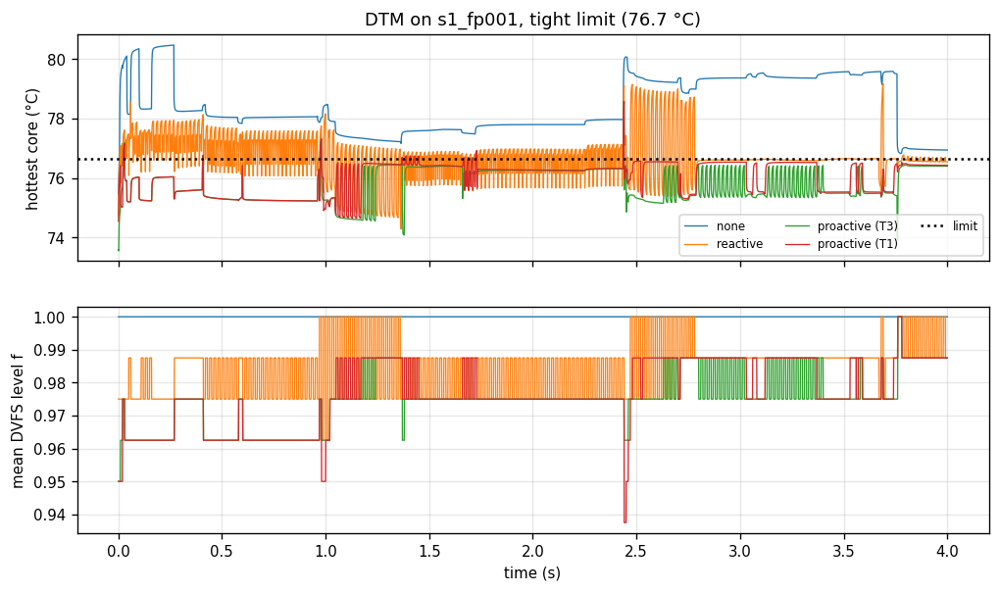

# P6-2 [WISH]: Reactive vs proactive DTM

**Question (the problem statement's wishlist).** Does a forecast from the calibrated predictor
make dynamic thermal management *proactive*, acting before the limit is crossed, and is that
better than reactive DTM? Does predictor accuracy matter?

**Reproduce.** `bash experiments/run.sh P6-2_dtm` (about 30 min; 20 closed-loop HotSpot runs).

## Setup

- **The chip:** HotSpot grid 64×64 driven step by step (P6-1), Δt = 1 ms, 4 s per run, starting
  warm (steady state of the workload's average power). Sensors = core temperatures.
- **Workload:** every core requests power from a phase trace within the TA ranges (requests change
  every 1 ms to 2 s; at least mid-range, so the chip runs hot).
- **Actuator:** per-core DVFS level f ∈ {1.0, 0.9, …, 0.5}; delivered power =
  request × (0.2 + 0.8 f³) (20 % static); work done ∝ f ("throughput" = mean f).
- **One decision every 10 ms.** Two floorplans (s1_fp001: hot, dense; s4_fp001: cool, sparse) and
  two limits each: *normal* (midway between the TA nominal and max peaks: 79.7 / 71.6 °C) and
  *tight* (3 K lower: 76.7 / 68.6 °C).
- **Policies:**
  - *none*: f = 1 always.
  - *reactive*: a core over the limit drops one level; below limit − 1 K it climbs one.
  - *proactive*: every 10 ms, forecast the next 20 ms for candidate levels (assuming each core's
    request stays as it is), then pick the fastest levels whose forecast stays below
    limit − 0.2 K (greedy: try one level faster, slow the worst core until the forecast is clear).
    Forecaster: **T3** (M = 4, anchored on the sensors, as in P3-2), **T1** (worse model), or
    **persistence** (no model: "temperature stays as it is").

## Results

| floorplan | limit | policy | peak (°C) | core-ms over limit | ms any core over | episodes | throughput | decision time |
|---|---|---|---|---|---|---|---|---|
| s1_fp001 | normal 79.7 °C | none | 80.5 | 194 | 194 | 4 | 1.000 | – |
| | | reactive | 80.4 | 88 | 88 | 12 | 1.000 | – |
| | | **proactive (T3)** | 79.9 | **2** | 2 | 1 | 0.998 | 0.41 ms |
| | | proactive (T1) | 79.9 | 2 | 2 | 1 | 0.998 | 0.44 ms |
| | | proactive (persistence) | 80.2 | 32 | 32 | 5 | 0.995 | 0.46 ms |
| s4_fp001 | normal 71.6 °C | none | 72.1 | 990 | 990 | 1 | 1.000 | – |
| | | reactive | 72.0 | 173 | 173 | 31 | 0.999 | – |
| | | **proactive (T3)** | 71.3 | **0** | 0 | 0 | 0.997 | 0.41 ms |
| | | proactive (T1) | 71.3 | 0 | 0 | 0 | 0.997 | 0.45 ms |
| | | proactive (persistence) | 71.7 | 9 | 9 | 2 | 0.993 | 0.47 ms |
| s1_fp001 | tight 76.7 °C | none | 80.5 | 10,400 | 4,000 | 1 | 1.000 | – |
| | | reactive | 79.2 | 2,900 | 2,060 | 236 | 0.985 | – |
| | | **proactive (T3)** | 78.6 | **22** | 22 | 5 | 0.975 | 0.60 ms |
| | | proactive (T1) | 78.6 | 61 | 61 | 13 | 0.977 | 0.60 ms |
| | | proactive (persistence) | 78.7 | 665 | 470 | 60 | 0.937 | 0.47 ms |
| s4_fp001 | tight 68.6 °C | none | 72.1 | 14,300 | 4,000 | 1 | 1.000 | – |
| | | reactive | 70.8 | 3,890 | 3,010 | 162 | 0.976 | – |
| | | **proactive (T3)** | 70.4 | **63** | 63 | 14 | 0.960 | 0.67 ms |
| | | proactive (T1) | 70.5 | 100 | 95 | 21 | 0.963 | 0.48 ms |
| | | proactive (persistence) | 71.3 | 1,500 | 1,180 | 119 | 0.908 | 0.42 ms |

(Other scenarios: `results/dtm_<floorplan>_<normal|tight>.png`.)

## Conclusion

- **Proactive DTM with the calibrated predictor almost eliminates limit violations.** With the
  tight limit, time over the limit drops from 2,900–3,900 core-ms (reactive) to 22–63 core-ms,
  a 60–130× reduction; with the normal limit, from 88–173 to 0–2. Reactive DTM by design only acts
  *after* a core is over, then oscillates around the limit (162–236 separate episodes; the orange
  saw-tooth in the figure).
- **The price is small:** 1–1.6 % less throughput than reactive DTM at the tight limit (0.975 against
  0.985, 0.960 against 0.976), and 0.1–0.2 % at the normal limit. Proactive DTM throttles a
  little *before* it is needed instead of a lot after.
- **Predictor accuracy matters.** Without a model (persistence), the controller only sees the
  current temperature: it violates the limit 20–30× more than with T3 *and* loses the most
  throughput (0.91–0.94), because it reacts late and then over-corrects. T1 does almost as well
  as T3 here (it errs on the safe side at a 20 ms horizon), but has 1.6–2.8× more violations at
  the tight limit.
- **The remaining violations** come from (i) the warm start already being above the tight limit on
  s1_fp001 (78.2 °C against 76.7 °C) and (ii) requests that jump within one 10 ms decision
  interval (e.g. at t ≈ 3.7 s). No policy can react to those without a shorter interval or advance
  knowledge of the workload.
- **Decision cost:** 0.4–0.7 ms per decision (Python, up to 48 forecasts per decision), which is
  4–7 % of the 10 ms interval. A vectorised or compiled version would be well under 0.1 ms.
- Not done: big → little task migration as a DTM action (the plan's open decision 3). P6-3 shows
  the steady model choosing core placements; combining both is a natural next step.

## Files

- `results/results.csv`, `results/summary.json`, `results/dtm_<floorplan>_<scenario>.png`,
  `results/log.txt`.
