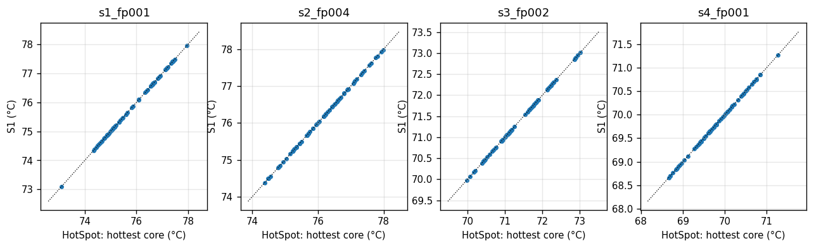

# P6-3 [WISH]: Demo: which cores should run the busy tasks?

**Question.** A scheduler must place 4 busy tasks on 4 of the 8 cores. Which placement keeps the
chip coolest? Can the calibrated steady predictor answer this as well as HotSpot, and how much
faster?

**Reproduce.** `bash experiments/run.sh P6-3_core_selection_demo` (about 3 min).

## Setup

- Main subset (one floorplan per style). Busy cores run at the top of their range (big 20 W,
  little 10 W), idle cores at the bottom (big 10 W, little 5 W). All C(8,4) = 70 placements.
- Each placement is scored by
  - its **hottest core** (core averages): S1 vs HotSpot (70 steady runs);
  - its **hottest spot** (hottest grid cell inside any core): S1-hot-max (P2-3: the max over every
    grid cell inside the cores) vs HotSpot's maps.
- "Regret" = how much hotter (in HotSpot) the placement picked by the predictor is than the
  true best placement.

## Results

| floorplan | best placement (S1 = HotSpot?) | rank correlation S1 vs HotSpot | regret | best by hot spot (S1-hot-max = HotSpot?) | rank correlation | regret | spread worst − best | S1: all 70 | HotSpot: all 70 |
|---|---|---|---|---|---|---|---|---|---|
| s1_fp001 | 0B+1B+2L+4L, **same** | 1.000 | 0 K | **same** | 1.000 | 0 K | 4.9 K | 7.1 µs | 63 CPU-s |
| s2_fp004 | 1B+2L+4L+6L, **same** | 1.000 | 0 K | **same** | 1.000 | 0 K | 3.6 K | 7.3 µs | 54 CPU-s |
| s3_fp002 | 3L+4L+5L+6L, **same** | 1.000 | 0 K | **same** | 1.000 | 0 K | 3.0 K | 6.9 µs | 51 CPU-s |
| s4_fp001 | 2L+3L+5L+7L, **same** | 1.000 | 0 K | **same** | 1.000 | 0 K | 2.6 K | 7.4 µs | 49 CPU-s |

(B = big core, L = little core, numbered as in the floorplan.)

## Conclusion

- **The calibrated predictor makes the same decision as HotSpot, about 7,000,000× faster.** S1
  ranks all 70 placements exactly like HotSpot (rank correlation 1.000, scores within 2×10⁻⁵ K)
  and picks the same coolest placement on every floorplan, in about 7 µs for all 70 together,
  against 49-63 CPU-seconds for 70 HotSpot runs (timed on this laptop; an earlier run on a busier
  machine gave 12 µs and about 100 CPU-seconds).
- **The choice matters**: the worst placement is 2.6–4.9 K hotter than the best, the same order as
  a DVFS step.
- **For the hot-spot objective, S1-hot-max makes the same choice as HotSpot on all 4 floorplans**
  and ranks all 70 placements identically (rank correlation 1.000), because it is exact.
- Note how the best placements differ by floorplan: on s1_fp001 the busy tasks should use both
  big cores (lower power density), on s2_fp004 one big core, and on s3_fp002 and s4_fp001 four
  spread-out little cores are cooler. Only a floorplan-specific model can know this.

## Files

- `results/results.csv`, `results/scores.png`, `results/summary.json`, `results/log.txt`.
