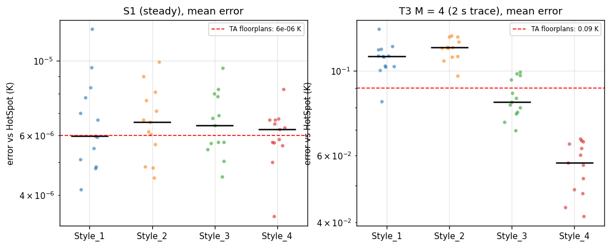

# Extended validation: S1 and T3 (M = 4) on 52 generated floorplans

**Question.** Are the errors of S1 and T3 on the TA floorplans typical, or specific to them?

**Reproduce.** `bash experiments/run.sh extended_validation` (about 100 min on a laptop with
8 workers: 78 min calibration, 18 min steady tests, 3 min transient tests; everything cached in
`~/ltp_runs`). `--dry` runs 4 floorplans only. Local only, not pushed to GitHub.

## Setup

- 52 floorplans from `src/sim/tagen.py`: 13 per style (`gen_001`..`gen_013`). `gen_001..010` are the
  40 of P0-5d; `gen_011..013` are 12 new ones (the generator is deterministic, so the first 10
  per style are unchanged).
- Per floorplan: calibrate S1 (8 steady runs) and T3 M = 4 (all 24 runs of P1-1); test against
  HotSpot with S1 on 302 steady vectors (TA nominal, max, 300 random) and T3 on one 2 s phase
  trace from a cold chip (the "short" test of P3-1). Errors over the 8 cores.
- Known duplicates: `s3_fp005` of the TA set is `s3_fp004` rotated, and `g1_gen010` is a rotated
  TA `s1_fp002`.

## Results

| Style | n | S1 mean | S1 worst | T3 mean | T3 worst | T3 hottest-core accuracy (min) |
|---|---|---|---|---|---|---|
| Style_1 | 13 | 6.8e-6 K | 3.4e-5 K | 0.108 K | 0.34 K | 96% |
| Style_2 | 13 | 6.7e-6 K | 2.6e-5 K | 0.114 K | 0.32 K | 99% |
| Style_3 | 13 | 6.6e-6 K | 2.8e-5 K | 0.085 K | 0.31 K | 88% |
| Style_4 | 13 | 6.1e-6 K | 2.6e-5 K | 0.056 K | 0.26 K | 94% |
| **all** | 52 | 6.5e-6 K | 3.4e-5 K | 0.091 K | 0.34 K | 88% |
| TA reference | 24 | 6e-6 K | 3e-5 K | 0.090 K | 0.30 K | |

S1 picks the right hottest core in 100% of the test vectors on every floorplan. Prediction time:
S1 1.2 µs, T3 3.2 µs per step. Calibration: about 780 s of HotSpot time per floorplan for T3 (5 s
for S1 alone). Worst peak-temperature error: S1 3.4e-5 K, T3 0.30 K.

## Conclusion

- The TA results hold: on 52 floorplans S1 and T3 are as accurate as on the 23 TA floorplans
  (S1 6.5e-6 K vs 6e-6 K; T3 0.091 K vs 0.090 K mean).
- T3's mean error depends a little on style (0.056 K to 0.114 K); the within-style spread is of
  similar size. Three floorplans had a worst error just above 0.30 K (largest 0.34 K, `g1_gen011`).
- T3's hottest-core accuracy is lower on some floorplans (88% on `g3_gen009`): cores whose
  temperatures differ by less than T3's error get swapped. The peak value itself is within 0.30 K.
- Limits: one 2 s test trace per floorplan (no long or noisy traces), 8 cores only (like the TA
  set), and the generator's floorplans share their styles' structure with the TA ones.

## Heatmaps and traces (`maps.py`)

One new floorplan per style (`g1..g4_gen012`, picked before looking at errors) and one random
steady power vector from the test set. `results/heatmaps.png` shows HotSpot's 64x64 grid map,
HotSpot's block averages, S1's prediction and their difference; `results/transient_check.png`
shows T3 against HotSpot on the 2 s trace (hottest core). Run:
`PYTHONPATH=.:experiments python3 experiments/extended_validation/maps.py` (needs the cache from
`run.py`; a few seconds).

- S1 minus HotSpot block average: at most 10-19 µK in any block (HotSpot's six-decimal output).
- The hottest grid cell is 1.3, 2.2, 3.7 and 4.0 K above the hottest core's block average (Style_1
  to Style_4). The models predict block averages, so they do not show this within-block hot spot.
- T3 on these four traces: mean 0.110 / 0.124 / 0.085 / 0.060 K, worst 0.26 / 0.27 / 0.24 / 0.19 K.
- `results/heatmaps_t3.png`: the same four panels for T3 (M = 4) at t = 2 s of the 2 s trace. HotSpot
  writes grid maps for every step (0.5 GB per run), so `maps.py` reads the last sample only. T3 is
  within 0.18 / 0.25 / 0.17 / 0.14 K of HotSpot in every block, slightly too cool everywhere.

## T3 heatmaps over time (`maps_time.py`)

The same four floorplans with a new 5 s phase trace from a cold chip (1 ms steps). For each
floorplan, `results/heatmaps_t3_time_<floorplan>.png` shows HotSpot's 64x64 grid map, HotSpot's block
averages, T3's prediction and their difference at t = 2.0, 2.5, ..., 5.0 s (one shared colour scale
per figure). `results/t3_error_over_time.png` is T3's worst core error over the whole trace.
HotSpot's grid transient file holds every step (about 1.2 GB for 5000 steps), so each run is read
once for the 7 wanted steps and deleted; the snapshots are cached in `~/ltp_runs/extended_maps/`.
Run: `PYTHONPATH=.:experiments python3 experiments/extended_validation/maps_time.py` (about 3 min).

| floorplan | worst core error at the 7 snapshots | mean over 5 s | worst over 5 s | share of time T3 is too cool |
|---|---|---|---|---|
| g1_gen012 | 0.075-0.21 K | 0.109 K | 0.29 K | 82 % |
| g2_gen012 | 0.044-0.19 K | 0.113 K | 0.30 K | 84 % |
| g3_gen012 | 0.071-0.19 K | 0.087 K | 0.30 K | 83 % |
| g4_gen012 | 0.033-0.13 K | 0.062 K | 0.26 K | 79 % |

- T3's map changes with HotSpot's as the hot core moves; every core is within 0.21 K at every
  snapshot.
- Errors are largest after power changes (0.11-0.21 K at 2-3 s) and shrink as the chip settles
  (0.03-0.10 K at 4.5-5 s); the worst moments (0.26-0.30 K) are short spikes after power steps.
- T3 is mostly slightly too cool, but not always (a few blocks are about +0.05 K at 5 s on g2).
- Per-snapshot numbers: `results/heatmaps_time_summary.csv`.

## Files

`run.py`, `maps.py`, `maps_time.py`; `results/heatmaps.png`, `results/heatmaps_t3_time_*.png`, `results/t3_error_over_time.png`, `results/heatmaps_time_summary.csv`, `results/transient_check.png`, `results/heatmaps_summary.csv`, `results/all_results.csv` (per floorplan), `results/summary.csv`, `results/summary.json`
(incl. phase timings), `results/error_by_style.png`, `results/log.txt`.
