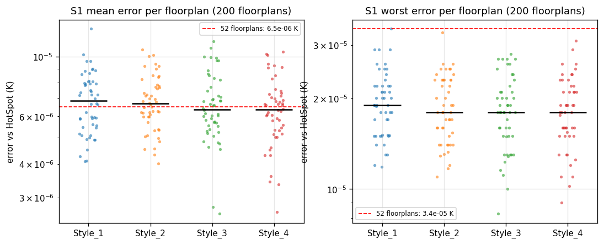

# Extended S1 validation: 200 generated floorplans

**Question.** Does S1's accuracy on the 52 floorplans of `extended_validation` hold on a much
larger generated set?

**Reproduce.** `LTP_WORKERS=20 bash experiments/run.sh extended_validation_s1` (6.9 min with 20
workers: 27 s to generate, 109 s calibration, 275 s steady tests; cached in `~/ltp_runs`).

## Setup

- 200 floorplans from `src/sim/tagen.py`, 50 per style (`gen_001`..`gen_050`). The generator is
  deterministic, so `gen_001..013` are the 52 floorplans of `extended_validation`.
- Per floorplan: calibrate S1 from the 8 steady unit runs, then test against HotSpot on 15 steady
  vectors (TA nominal, max, 13 random within the TA ranges). Errors are taken over the 8 cores.
- 15 vectors instead of 302 to keep the run short. S1 is linear and HotSpot is linear, so more vectors
  add little information (the 52-floorplan run with 302 vectors gave the same errors).

## Results

| Style | n | S1 mean | worst mean (one floorplan) | S1 worst | worst peak error | hottest-core accuracy (min) |
|---|---|---|---|---|---|---|
| Style_1 | 50 | 6.9e-6 K | 1.3e-5 K | 3.4e-5 K | 3.4e-5 K | 100% |
| Style_2 | 50 | 6.9e-6 K | 1.1e-5 K | 3.3e-5 K | 2.6e-5 K | 100% |
| Style_3 | 50 | 6.7e-6 K | 1.1e-5 K | 2.8e-5 K | 2.7e-5 K | 100% |
| Style_4 | 50 | 6.5e-6 K | 1.0e-5 K | 3.1e-5 K | 2.5e-5 K | 100% |
| **all** | 200 | 6.7e-6 K | 1.3e-5 K | 3.4e-5 K | 3.4e-5 K | 100% |
| 52 floorplans (302 vectors) | 52 | 6.5e-6 K | | 3.4e-5 K | 3.4e-5 K | 100% |

Prediction time 1.6 µs (median; measured right after the 20-worker pool, so slightly above the
1.2 µs of the 52-floorplan run). Model size 640-1792 B (it grows with the number of blocks in the floorplan).

## Conclusion

- S1 is exact to HotSpot's output precision on all 200 floorplans: mean 6.7e-6 K, worst 3.4e-5 K,
  the same as on the 52 and the TA floorplans. No style and no single floorplan stands out.
- S1 picks the hottest core correctly for every test vector on every floorplan.
- Duplicates: Style_1 has few possible layouts, so the generator repeats some (up to a rotation or
  mirror). 13 pairs, all in Style_1, fall into 8 groups of identical layouts (flagged by equal
  eigenvalues of the 8x8 core matrix on the same die; listed in `results/summary.json`). That
  leaves 191 distinct floorplans (41 in Style_1). The conclusion does not change.

## 500 floorplans (`--per-style 125`, `results_500/`)

The same test on 125 floorplans per style (`gen_001`..`gen_125`; the first 50 are the run above).
11.7 min with 20 workers (64 s generate, 220 s calibration, 414 s steady tests). Log: redirect it
yourself (`run.sh` writes to `results/log.txt`).

| Style | n (distinct) | S1 mean | worst mean (one floorplan) | S1 worst | worst peak error | hottest-core accuracy (min) |
|---|---|---|---|---|---|---|
| Style_1 | 125 (75) | 7.0e-6 K | 1.3e-5 K | 3.4e-5 K | 3.4e-5 K | 100% |
| Style_2 | 125 (121) | 6.8e-6 K | 1.2e-5 K | 3.3e-5 K | 2.6e-5 K | 100% |
| Style_3 | 125 (123) | 7.0e-6 K | 1.2e-5 K | 3.1e-5 K | 2.7e-5 K | 100% |
| Style_4 | 125 (125) | 6.8e-6 K | 1.1e-5 K | 3.6e-5 K | 2.7e-5 K | 100% |
| **all** | 500 (444) | 6.9e-6 K | 1.3e-5 K | 3.6e-5 K | 3.4e-5 K | 100% |

- Same result as on 200, 52 and the TA floorplans: S1 matches HotSpot to its six-decimal output on
  every floorplan, and always picks the right hottest core.
- 95 duplicate pairs leave 444 distinct layouts. Style_1 saturates (75 distinct of 125), so more
  Style_1 floorplans from this generator add little.
- Model size 640-1856 B, growing with the number of blocks. Prediction time 2.2 µs median here
  (measured on a loaded machine right after the pool; 1.2 µs in the quiet 52-floorplan run).

## Files

`run.py`; `results/all_results.csv` (per floorplan), `results/summary.csv`, `results/summary.json`
(incl. timings and duplicate pairs), `results/error_by_style.png`, `results/log.txt`; the same files
for the 500-floorplan run in `results_500/`.
