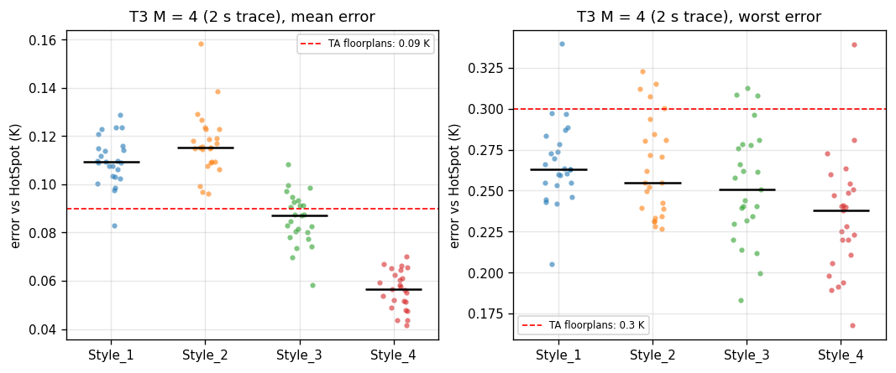

# Extended T3 validation: T3 (M = 4) on 100 generated floorplans

**Question.** Does T3's accuracy on the 52 floorplans of `extended_validation` hold on a larger
generated set? (S1 is already validated on 500 floorplans in `extended_validation_s1`, so this run
tests the transient model only.)

**Reproduce.** `bash experiments/run.sh extended_validation_t3` (83 min on a laptop with 8 workers:
80 min calibration, 3.5 min transient tests; cached in `~/ltp_runs`). The 52 floorplans of
`extended_validation` were already cached, so only 48 were calibrated; from scratch, expect about
2.5 h. `--per-style N` runs 4N floorplans into `results_<4N>/`.

## Setup

- 100 floorplans from `src/sim/tagen.py`, 25 per style (`gen_001`..`gen_025`): the first 25 per style
  of the 500 in `extended_validation_s1`. The generator is deterministic, so `gen_001..013` are the
  52 of `extended_validation` and `gen_014..025` (48) are new for T3.
- Per floorplan: calibrate T3 M = 4 from all 24 runs of P1-1 (the 8 steady unit runs give G, the 16
  step responses give the exponentials), then test against HotSpot on one 2 s phase trace from a
  cold chip (the "short" test of P3-1, as in `extended_validation`). Errors over the 8 cores.
- No steady test and no S1 model: the steady unit runs are used only as part of T3's calibration.

## Results

| Style | n | T3 mean | worst mean (one floorplan) | T3 worst | worst peak error | hottest-core accuracy (min) |
|---|---|---|---|---|---|---|
| Style_1 | 25 | 0.110 K | 0.129 K | 0.34 K | 0.30 K | 96% |
| Style_2 | 25 | 0.117 K | 0.158 K | 0.32 K | 0.31 K | 97% |
| Style_3 | 25 | 0.086 K | 0.108 K | 0.31 K | 0.23 K | 88% |
| Style_4 | 25 | 0.056 K | 0.070 K | 0.34 K | 0.28 K | 94% |
| **all** | 100 | 0.092 K | 0.158 K | 0.34 K | 0.31 K | 88% |
| 52 floorplans (`extended_validation`) | 52 | 0.091 K | | 0.34 K | 0.30 K | 88% |
| 48 new floorplans (`gen_014..025`) | 48 | 0.094 K | | 0.34 K | | |
| TA reference (P3-1) | 24 | 0.090 K | | 0.30 K | | |

Prediction time 3.3 µs per step (median). Model size 2.6-7.2 kB (it grows with the number of
blocks). Calibration about 790 s of HotSpot time per floorplan.

## Conclusion

- T3's accuracy holds on 100 floorplans: mean 0.092 K, worst 0.34 K, the same as on the 52
  (0.091 K, 0.34 K) and the TA floorplans (0.090 K, 0.30 K). The 48 new floorplans alone give
  0.094 K mean, so the 52 were not a lucky sample.
- The style dependence seen on the 52 holds: Style_4 is most accurate (0.056 K mean), Style_2 least
  (0.117 K). The worst single floorplan is `g2_gen019` (0.158 K mean).
- 10 of 100 floorplans have a worst error just above 0.30 K (0.300-0.340 K; largest `g1_gen011`
  0.340 K and `g4_gen024` 0.339 K). Worst peak-temperature error is 0.31 K (`g2_gen022`).
- Hottest-core accuracy is 88% at worst (`g3_gen009`, as on the 52): cores whose temperatures
  differ by less than T3's error get swapped.
- Duplicates: by the list in `extended_validation_s1/results_500/summary.json`, 6 pairs among these
  100 (all in Style_1) fall into 4 groups of identical layouts, leaving 95 distinct (20 in Style_1).
  Each floorplan gets its own test trace, so duplicates are still separate tests (their errors
  differ); the conclusion does not change.
- Limits: as in `extended_validation`, one 2 s test trace per floorplan and 8 cores only.

## Files

`run.py`; `results/all_results.csv` (per floorplan), `results/summary.csv`, `results/summary.json`
(incl. phase timings), `results/error_by_style.png`, `results/log.txt`.
